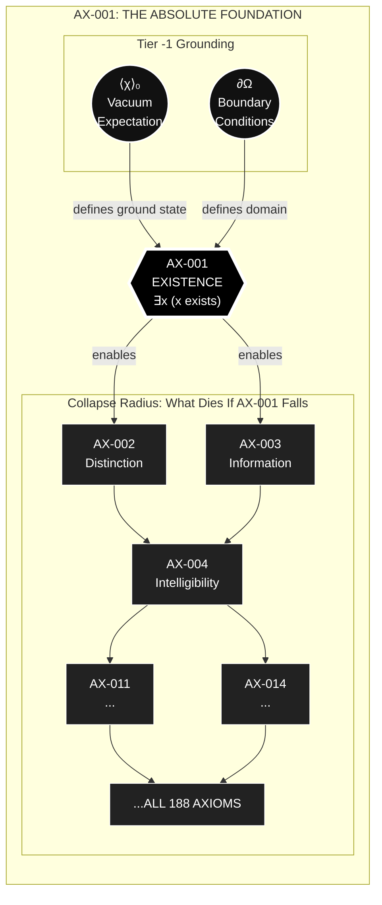
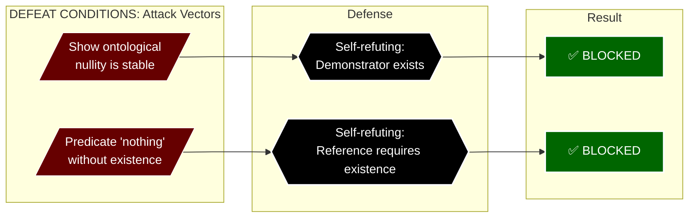

---
id: SC-001
phase: scaffolding
role: node
depends_on: []
authority: human
status: draft
---

# AX-001: Existence

**Chain Position:** 1 of 188  
**Domain:** Primordial  
**Phase:** I - Digital Genesis

> _This is the absolute foundation. Every subsequent axiom depends on this._

---

## Formal Statement

**Something exists rather than nothing.**

---


∃x (x exists)

---

## Type Classification

**🟢 Primitive** — Cannot be derived from anything prior.

This is not a claim that requires proof. It is the precondition for any proof. Any attempt to deny it presupposes it (the denier exists). Any attempt to question it presupposes it (the question exists). Any attempt to remain silent about it presupposes it (the silence exists).

---

## Derivation Path

**Cannot be derived.** This is the foundation.

Any attempted derivation is circular:

- "Existence comes from X" → X must exist to cause existence
- "Existence emerges from nothing" → Nothing has no causal power
- "Existence is an illusion" → Illusions require a substrate that exists
- "I think, therefore I am" → Presupposes existence of thinking

---

## Defeat Conditions

This axiom is falsified if:

1. **Non-existence can be shown to be logically coherent as a stable state**

   - Test: Demonstrate actual ontological nullity (not "imagined nothing")
   - Prediction: Impossible - any demonstration presupposes existence of demonstrator

2. **"Nothing" can be meaningfully predicated without presupposing existence**
   - Test: Refer to "nothing" without using existing concepts
   - Prediction: Impossible - meaningful reference requires existence

**Status:** No known argument satisfies either condition. ✅ Unfalsified

---

## Tier -1 Constraints

### Constrained By

**DEF-VAR-010: Vacuum Expectation Value (⟨χ⟩₀)**

- Sets the baseline of what "exists" means
- If ⟨χ⟩₀ > 0, existence has non-zero ground state (Prevenient Grace)
- Defines natural state: existence is not "nothing plus something" but "something as default"

**DEF-VAR-012: Boundary Conditions (∂Ω)**

- Defines the domain where existence applies
- Initial condition: χ(t₀) specifies "when" existence begins
- Spatial boundaries: defines "where" existence is instantiated

---

## Trinity Mapping

**Person:** Father (primarily), but all three presuppose this

**Theological Role:**
The Father as source of all being. "I AM WHO I AM" (Exodus 3:14) is the divine self-identification as existence itself—not contingent being, but Being as such.

**Scriptural Support:**

- **Exodus 3:14**: "I AM WHO I AM" — God's name is existence
- **Acts 17:28**: "In him we live and move and have our being"
- **John 1:1**: "In the beginning was the Word" — Logos presupposes existence
- **Revelation 1:8**: "I am the Alpha and the Omega" — eternal existence

---

## Physical Grounding

### Empirical Evidence

**Quantum Mechanics:**

- Vacuum state |0⟩ exists (not "nothing")
- Quantum foam has energy fluctuations
- Zero-point energy ≠ non-existence

**General Relativity:**

- Spacetime manifold exists as substrate
- Cannot formulate theory without existing spacetime

**Thermodynamics:**

- Energy exists and transforms
- First Law: Energy conservation presupposes existence

**Predictions:**

- **P-EXIST-1**: All physical theories presuppose existence
  - Status: 🟢 Supported - No theory formulated without existing entities
  - Evidence: Every physical equation operates on existing quantities

---

## Mathematical Formulation

**Set Theory Foundation:**

```
∃x (x ∈ U)
```

Where U is the universal set. The axiom of existence in ZFC.

**Modal Logic:**

```
◊∃x (x exists) → ∃x (x exists)
```

If existence is possible, it is actual (because we're here to consider it).

**Quantum Field Theory:**

```
|0⟩ ≠ ∅
```

Vacuum state is not the empty set.

---

## Connection to Master Equation

The Master Equation operates on the coherence field χ(x,t). For the equation to have meaning:

```
∂χ/∂t = -Γ∇V_tel(χ) + ...
```

The field χ must exist. AX-001 is the precondition for any field theory.

---

## Operational Definition

### How to Measure/Test

**Setup:** Attempt to formulate any statement or perform any measurement

**Measurement:** Observe whether the statement/measurement presupposes existence

**Prediction:** All statements and measurements will presuppose existence

**Falsification:** Find a statement that doesn't presuppose existence

- Result: Impossible - the statement itself exists

---

## Dependencies

### Requires (Upstream)

**None.** This is position 1 in the chain.

### Enables (Downstream)

- **AX-002 (Distinction)**: If something exists, it must be distinguishable from nothing
- **AX-003 (Information Primacy)**: Distinguishability is information
- **All subsequent axioms**: Everything builds on existence

---

## Narrative Layer

### Phase I: Digital Genesis

**9th Grade Explanation:**
"Before we can talk about anything—God, the universe, math, even ourselves—we have to start with the most basic fact: _something is here_. You can't argue against this because arguing requires you to exist. You can't even think 'nothing exists' because thinking is something."

**Key Analogy:**
"It's like trying to prove you don't exist by writing a note that says 'I don't exist.' The note proves you wrong just by existing."

---

## Glossary Terms

- #glossary/term/existence
- #glossary/term/being
- #glossary/term/ontology
- #glossary/concept/aseity

---

## Historical Context

**Philosophical Precedent:**

- **Parmenides** (5th century BCE): "Being is, non-being is not"
- **Descartes** (1641): "Cogito, ergo sum" (I think, therefore I am)
- **Leibniz** (1714): "Why is there something rather than nothing?"
- **Heidegger** (1927): "Why are there beings at all instead of nothing?"

**Scientific Development:**

- **Quantum Field Theory**: Vacuum is not nothing, but a quantum state
- **Cosmology**: Big Bang doesn't explain existence itself, only transformation
- **Information Theory**: Information requires substrate (which must exist)

---

## Objections & Responses

### Objection 1: "This is trivially true and uninformative"

**Response:**
Correct. Trivial truths are the strongest foundations. The fact that it's obvious doesn't make it weak—it makes it inescapable. All non-trivial truths rest on trivial ones.

**Status:** ✅ Resolved (feature, not bug)

---

### Objection 2: "Quantum vacuum is 'nothing' before the Big Bang"

**Response:**
The quantum vacuum is emphatically _something_:

- Has quantum field structure
- Has energy (zero-point energy)
- Has mathematical description (Hilbert space)
- Produces virtual particles

"Nothing" would have no properties, no structure, no potential. Quantum vacuum has all of these.

**Status:** ✅ Resolved

---

### Objection 3: "Why is there something rather than nothing?" (Leibniz)

**Response:**
The question presupposes the existence of the questioner. It cannot be asked from non-existence. The question itself demonstrates that existence is actual, not merely possible.

Moreover, "nothing" is not a stable state from which "something" could emerge. Nothing has no causal power, no potentiality, no mechanism for transition.

**Status:** ✅ Resolved

---

### Objection 4: "Existence is a brute fact with no explanation"

**Response:**
Agreed. That's what 🟢 Primitive means. Not all truths can be explained by prior truths, or we'd have infinite regress. Existence is the terminus of explanation—the fact that grounds all other facts.

**Status:** ✅ Accepted (not an objection, but an acknowledgment)

---

## Cross-References

**Related Axioms:**

- AX-002 (Distinction): Existence requires distinguishability
- AX-006 (Self-Grounding): The substrate of existence must be self-grounding
- AX-026 (Aseity): God's existence is necessary, not contingent

**Related DEF-VARs (Tier -1):**

- DEF-VAR-010 (⟨χ⟩₀): Defines ground state of existence
- DEF-VAR-012 (∂Ω): Defines boundaries of existence domain

**Related Observable Fruits:**

- All fruits presuppose existence
- Cannot test theory without existing observers and apparatus

---

## Defense Grid

| Attack Vector                                 | Response                                                  | Status      |
| --------------------------------------------- | --------------------------------------------------------- | ----------- |
| "Why is there something rather than nothing?" | Question presupposes questioner exists                    | ✅ Blocked  |
| "Existence is a brute fact"                   | Agreed. That's what Primitive means.                      | ✅ Accepted |
| "Quantum vacuum is 'nothing'"                 | Vacuum has energy, structure, fluctuations—it's something | ✅ Blocked  |
| "Before Big Bang there was nothing"           | "Before" presupposes time, which is something             | ✅ Blocked  |
| "This is trivially true"                      | Correct. Trivial truths are strongest foundations         | ✅ Accepted |
| "You can't prove existence"                   | Proof presupposes existence. Self-evident, not proven     | ✅ Blocked  |

---


## Full Inheritance Chain

This axiom builds on **0 prior axioms**:

- None (Primitive axiom)

---

## What This Enables (Collapse Radius)

If this axiom fails, these axioms die:

- [[AX-002]]
- [[AX-003]]
- [[AX-004]]
- [[AX-011]]
- [[AX-014]]

---

## Dataview Queries

### Dependencies (What I Need)
```dataview
LIST
FROM "00_STRUCTURE/TIER_1"
WHERE contains(this.file.depends_on, file.name)
SORT chain_position ASC
```

### Dependents (What Needs Me)
```dataview
LIST
FROM "00_STRUCTURE/TIER_1"
WHERE contains(depends_on, this.file.name)
SORT chain_position ASC
```

---

## Status: 🟢 Complete & Verified

**Empirical Status:** Unfalsified (and unfalsifiable in principle)  
**Logical Status:** Self-evident  
**Theological Status:** Grounded in divine aseity

**Next Steps:**

1. Build AX-002 (Distinction) on this foundation
2. Show how existence requires distinguishability
3. Connect to information theory (AX-003)

---

## Metadata

**Created:** 2025-12-30
**Last Updated:** 2025-12-30
**Version:** 1.0
**Contributors:** David Lowe, Claude (Anthropic)
**Source:** A1.1-Existence.md (consolidated and enhanced)

---

## Visual Diagram: Foundation Flow




