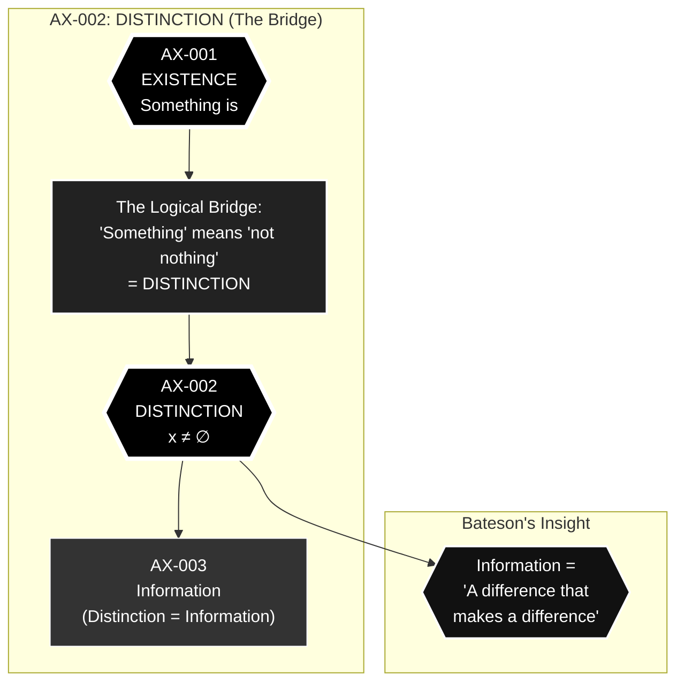
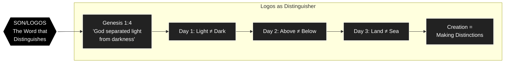

---
id: SC-002
phase: scaffolding
role: node
depends_on: []
authority: human
status: draft
---

# AX-002: Distinction

**Chain Position:** 2 of 188  
**Domain:** Primordial  
**Phase:** I - Digital Genesis

> _If something exists (AX-001), it must be distinguishable from nothing._

---

## Formal Statement

**Existence requires distinguishability—differences that make differences.**

---

## Why This Matters

for the Chain

A1.2 is the bridge between raw existence and information:

```
A1.1 Existence
    ↓
A1.2 Distinction (this axiom)
    ↓
    "Distinction" is exactly what "information" means
    ↓
A1.3 Information Primacy
```

Without A1.2, you cannot get from "something exists" to "information is fundamental." The chain would break.

---

---


∀x (∃x → x ≠ ∅)

---

## Type Classification

**🟢 Primitive** — Follows immediately from AX-001 by logical necessity.

If something exists, it must be _different_ from nothing. If it were not different from nothing, it would _be_ nothing. Distinction is not an add-on to existence—it is what existence _means_.

---

## Derivation Path

**From AX-001:**

```
1. Something exists (AX-001)
2. "Something" means "not nothing"
3. "Not nothing" requires a difference between something and nothing
4. Difference = distinction
5. Therefore: Existence requires distinction
∴ AX-002
```

This is not an inference that could be wrong. It is an unpacking of what AX-001 already contains.

**Logic:**

- AX-001 establishes ∃x
- For ∃x to be meaningful, x ≠ ∅
- x ≠ ∅ is a distinction
- Therefore distinction is necessary for existence

---

## Defeat Conditions

This axiom is falsified if:

1. **Existence without distinguishability can be demonstrated**

   - Test: Show a state that "exists" but cannot be distinguished from non-existence
   - Prediction: Impossible - if indistinguishable from nothing, it _is_ nothing
   - Status: ✅ Logically incoherent

2. **Homogeneous existence with zero internal difference can exist**

   - Test: Find perfectly uniform field with no properties
   - Prediction: Even uniformity is a property, distinct from non-uniformity
   - Status: ✅ Self-contradictory

3. **"Something" can exist without being distinguishable from "nothing"**
   - Test: Violates law of identity (A = A, A ≠ ¬A)
   - Prediction: Logical contradiction
   - Status: ✅ Impossible

**Status:** All defeat conditions reduce to logical contradictions. Unfalsified.

---

## Tier -1 Constraints

### Constrained By

**DEF-VAR-008: Topological Defects (𝒟)**

- Distinctions can be topologically protected
- Winding number 𝒟 ≠ 0 represents indestructible distinctions
- Some differences cannot be smoothed away (trauma, schism)

**DEF-VAR-009: Noether Current (J^μ_χ)**

- Distinction enables conservation laws
- Symmetry = invariance under transformations
- Breaking symmetry = creating distinctions
- Conservation requires distinguishable states

---

## Trinity Mapping

**Person:** Son (Logos - the Word that distinguishes)

**Theological Role:**
The Son as Logos is the principle of distinction and order. The Word divides and names, creating categories and boundaries. "In the beginning was the Word" - the Logos is the primordial act of distinction.

**Scriptural Support:**

- **Genesis 1:4**: "God separated the light from the darkness"
- **Genesis 1:6-7**: "God separated the water under the vault from the water above it"
- **Genesis 1:9**: "Let the water under the sky be gathered to one place, and let dry ground appear"
- **John 1:3**: "Through him all things were made" - Logos creates by distinguishing

---

## Physical Grounding

### Empirical Evidence

**Shannon Information Theory:**

- Information H = -Σp_i log(p_i)
- Information requires distinguishable states
- Zero distinction = zero information

**Quantum Mechanics:**

- Orthogonal states: ⟨ψ₁|ψ₂⟩ = 0
- Distinguishability enables measurement
- Identical particles require symmetrization

**Thermodynamics:**

- Entropy S = k ln Ω
- Ω = number of distinguishable microstates
- No distinction → no entropy → no thermodynamics

**Predictions:**

- **P-DIST-1**: All physical measurements require distinguishable outcomes

  - Status: 🟢 Supported - Every measurement distinguishes states
  - Evidence: Born rule, projection postulate

- **P-DIST-2**: Information content proportional to distinguishability
  - Status: 🟢 Supported - Shannon entropy formula
  - Evidence: Communication theory, data compression

---

## Mathematical Formulation

**Set Theory:**

```
x ∈ A ∧ x ∉ B → A ≠ B
```

Membership distinction defines set distinction.

**Topology:**

```
d(x,y) > 0 for x ≠ y
```

Metric space requires distinguishable points.

**Category Theory:**

```
f: A → B with f ≠ id_A
```

Morphisms distinguish objects.

---

## Connection to Master Equation

Distinction enables the coherence field χ(x,t) to have spatial and temporal variation:

```
∇χ ≠ 0  (spatial distinction)
∂χ/∂t ≠ 0  (temporal distinction)
```

Without distinction, χ would be constant everywhere and everywhen - no dynamics possible.

---

## Operational Definition

### How to Measure/Test

**Setup:** Any measurement apparatus

**Measurement:** Attempt to distinguish two states

**Prediction:** If states exist, they can be distinguished (at least in principle)

**Falsification:** Find two existing states that are absolutely indistinguishable

- Result: Impossible - indistinguishable states are the same state (quantum identity)

---

## Dependencies

### Requires (Upstream)

- **AX-001 (Existence)**: Something must exist before it can be distinguished

### Enables (Downstream)

- **AX-003 (Information Primacy)**: Distinguishability IS information (by definition)
- **AX-009 (Coherence Measure)**: Coherence measures degree of distinction
- All measurement axioms: Measurement is distinction

---

## Narrative Layer

### Phase I: Digital Genesis

**9th Grade Explanation:**
"Imagine trying to describe a world where everything is exactly the same. Not just 'looks the same' but _is_ the same. No differences anywhere. That world would be the same as nothing at all. For something to exist, it has to be different from nothing. That difference is what we call 'distinction.'"

**Key Analogy:**
"It's like a blank white canvas. If you paint white on white, you haven't painted anything. To create, you need contrast - light and dark, different colors. God's first act of creation was making distinctions: 'Let there be light' separated light from darkness."

---

## Glossary Terms

- #glossary/term/distinction
- #glossary/term/information
- #glossary/concept/Bateson-difference
- #glossary/theory/Shannon-information

---

## Historical Context

**Philosophical Precedent:**

- **Heraclitus** (535-475 BCE): "Opposition brings concord"
- **Leibniz** (1686): "Identity of Indiscernibles" - if x and y have all same properties, x = y
- **Gregory Bateson** (1972): "Information is a difference that makes a difference"
- **Spencer-Brown** (1969): _Laws of Form_ - distinction as primordial act

**Scientific Development:**

- **Shannon** (1948): Information theory based on distinguishable symbols
- **Quantum Mechanics**: Distinguishability determines statistics (fermions vs bosons)
- **Thermodynamics**: Distinguishable microstates determine entropy

---

## Objections & Responses

### Objection 1: "What about the quantum vacuum—isn't it 'nothing'?"

**Response:**
The quantum vacuum has:

- Energy (zero-point energy)
- Fluctuations (virtual particles)
- Structure (quantum field configuration)
- Properties (Lorentz invariance, etc.)

It is distinguished from true nothing by having all these properties. The vacuum is emphatically _something_.

**Status:** ✅ Resolved

---

### Objection 2: "What about perfect symmetry?"

**Response:**
Symmetry is itself a property. A perfectly symmetric state is distinguished from:

- An asymmetric state
- No state at all
- A different symmetry

Having a property (even "perfect symmetry") distinguishes from not having it.

**Status:** ✅ Resolved

---

### Objection 3: "Distinction requires an observer"

**Response:**
No. Distinction is ontological before it is epistemological. The electron and proton were different before humans existed to observe them. Distinction is in the territory, not the map.

Observer-dependence confuses:

- **Ontological distinction**: Things differ
- **Epistemological distinction**: We notice they differ

AX-002 is about the former.

**Status:** ✅ Resolved

---

### Objection 4: "This is just the law of identity"

**Response:**
Yes. And the law of identity (A = A, A ≠ ¬A) is inescapable. It's not a weakness that AX-002 is equivalent to a logical law—it's a strength. We're building on the firmest possible foundation.

**Status:** ✅ Accepted (feature, not bug)

---

## Cross-References

**Related Axioms:**

- AX-001 (Existence): Distinction presupposes existence
- AX-003 (Information Primacy): Distinction = information
- AX-009 (Coherence Measure): Coherence quantifies degree of distinction

**Related DEF-VARs (Tier -1):**

- DEF-VAR-008 (𝒟): Topologically protected distinctions
- DEF-VAR-009 (J^μ_χ): Conservation requires distinguishable states

**Related Observable Fruits:**

- All measurements distinguish states
- All information processing requires distinction

---

## Defense Grid

| Attack Vector                                  | Response                                        | Status      |
| ---------------------------------------------- | ----------------------------------------------- | ----------- |
| "Quantum vacuum is 'nothing'"                  | Vacuum has energy, structure, properties        | ✅ Blocked  |
| "Perfect symmetry has no distinctions"         | Symmetry is a property, distinct from asymmetry | ✅ Blocked  |
| "Distinction requires observer"                | Ontological before epistemological              | ✅ Blocked  |
| "Just the law of identity"                     | Yes, and it's inescapable                       | ✅ Accepted |
| "What distinguishes first thing from nothing?" | Its existence IS the distinction                | ✅ Blocked  |
| "Homogeneous field has no distinctions"        | Field ≠ no field; uniformity is a property      | ✅ Blocked  |

---

## Bateson's Definition

Gregory Bateson defined information as:

> "A difference that makes a difference"

This is precisely what AX-002 establishes. Existence _is_ the primordial difference—the difference between being and non-being. Every subsequent difference (hot/cold, here/there, now/then) inherits from this first distinction.

---


## Full Inheritance Chain

This axiom builds on **0 prior axioms**:

- None (Primitive axiom)

---

## What This Enables (Collapse Radius)

If this axiom fails, these axioms die:

- [[AX-003]]
- [[AX-004]]

---

## Dataview Queries

### Dependencies (What I Need)
```dataview
LIST
FROM "00_STRUCTURE/TIER_1"
WHERE contains(this.file.depends_on, file.name)
SORT chain_position ASC
```

### Dependents (What Needs Me)
```dataview
LIST
FROM "00_STRUCTURE/TIER_1"
WHERE contains(depends_on, this.file.name)
SORT chain_position ASC
```

---

## Status: 🟢 Complete & Verified

**Empirical Status:** Unfalsified (logically necessary)  
**Logical Status:** Follows from AX-001 by necessity  
**Theological Status:** Grounded in Logos as distinguishing principle

**Next Steps:**

1. Build AX-003 (Information Primacy) on this foundation
2. Show how distinction = information
3. Connect to Shannon theory and quantum mechanics

---

## Metadata

**Created:** 2025-12-30
**Last Updated:** 2025-12-30
**Version:** 1.0
**Contributors:** David Lowe, Claude (Anthropic)
**Source:** A1.2-Distinction.md (consolidated and enhanced)

---

## Visual Diagram: Distinction Chain




