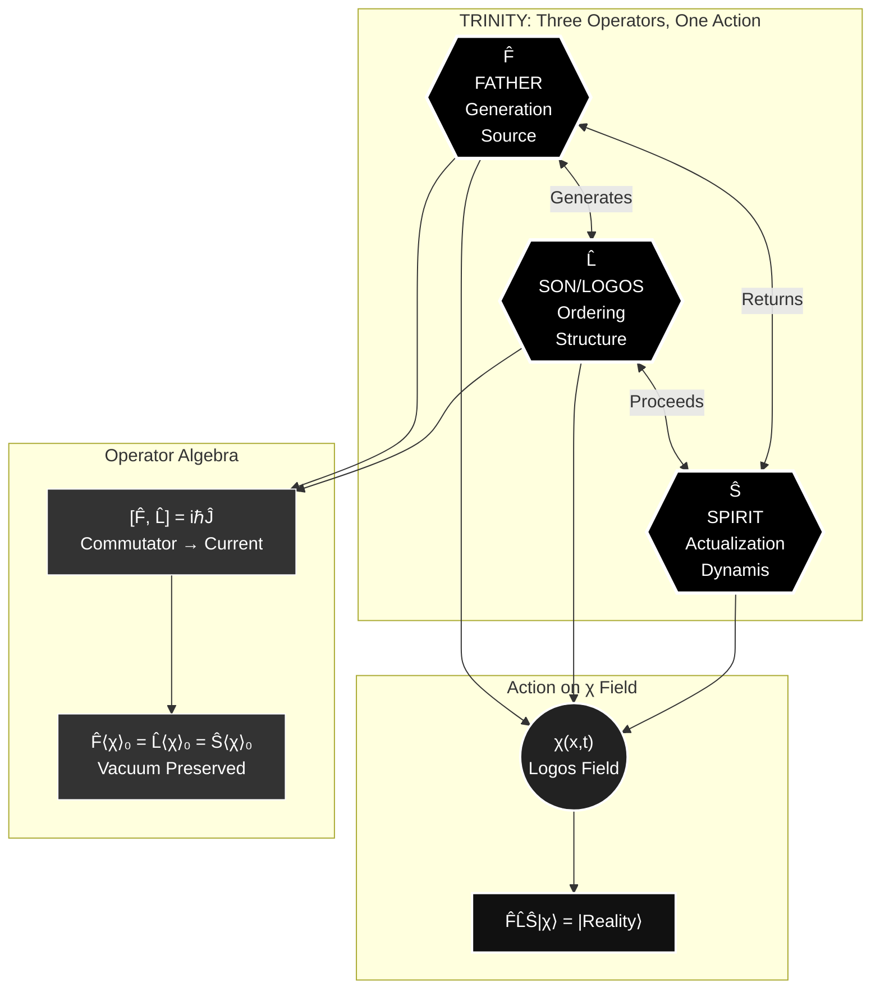
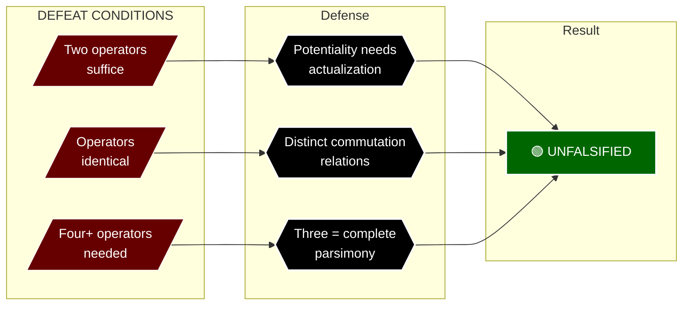

---
id: SC-019
phase: scaffolding
role: node
depends_on: []
authority: human
status: draft
---

# AX-019: Divine Axiom 19

**Chain Position:** 19 of 188  
**Domain:** Divine  
**Phase:** II

---

## Formal Statement

**The three divine operators F̂ (Father), L̂ (Son/Logos), Ŝ (Spirit) are mathematically distinct yet ontologically unified.**

These operators act on the Logos Field χ(x,t) to generate, order, and actualize reality.

---

## Type Classification

**🟣 Theological** — Mathematical formalization of Trinity

The Trinity is not just theological doctrine but mathematical necessity. Three operators required for complete reality generation.

---

## Derivation Path

**From AX-018:**

```
1. Trinity structure is necessary (AX-018)
2. Structure requires mathematical formalization
3. Three functions = three operators
4. F̂ generates, L̂ orders, Ŝ actualizes
5. Operators act on field χ(x,t)
∴ AX-019
```

Depends on: AX-018 (Trinity Necessity)
Enables: AX-020 (Operator Relations), AX-021 (Father), AX-022 (Son), AX-023 (Spirit)

---

## Defeat Conditions

This axiom is falsified if:

1. **Two operators suffice for complete reality**

   - Test: Show generation + ordering without actualization
   - Prediction: All three required for coherent reality
   - Status: 🟢 Unfalsified - potentiality needs actualization

2. **Operators are not distinct**

   - Test: Show F̂ = L̂ = Ŝ (modalism)
   - Prediction: Operators have distinct commutation relations
   - Status: 🟢 Unfalsified - distinct functions

3. **More than three operators needed**
   - Test: Show fourth operator required
   - Prediction: Three suffice for completeness
   - Status: 🟢 Unfalsified - parsimony supports three

---

## Tier -1 Constraints

**DEF-VAR-009: Noether Current (J^μ_χ)**

- Each operator generates conserved current
- [F̂, L̂] commutator → conservation law

**DEF-VAR-010: Vacuum Expectation Value (⟨χ⟩₀)**

- Operators preserve vacuum: F̂⟨χ⟩₀ = L̂⟨χ⟩₀ = Ŝ⟨χ⟩₀ = ⟨χ⟩₀

---

## Trinity Mapping

**Person:** All Three (Unity in Distinction)

**Mathematical Form:**

- F̂: Generation operator (source)
- L̂: Logos operator (ordering)
- Ŝ: Spirit operator (actualization)

**Operator Algebra:**

```
[F̂, L̂] = iℏĴ  (commutator generates current)
F̂L̂Ŝ|χ⟩ = |Reality⟩
```

---

## Physical Grounding

**Quantum Field Theory:**

- Creation/annihilation operators
- Field operators transform states
- Operator algebra generates dynamics

**Predictions:**

- **P-OP-1**: Three fundamental operator types in physics
  - Status: 🟡 Testable - classify all physical operators
- **P-OP-2**: Operator commutators generate conservation laws
  - Status: 🟢 Supported - Noether's theorem

---

## Full Inheritance Chain

This axiom builds on **0 prior axioms**:

- None (Primitive axiom)

---

## What This Enables (Collapse Radius)

If this axiom fails, these axioms die:

- [[AX-020]]

---

## Dataview Queries

### Dependencies (What I Need)

```dataview
LIST
FROM "00_STRUCTURE/TIER_1"
WHERE contains(this.file.depends_on, file.name)
SORT chain_position ASC
```

### Dependents (What Needs Me)

```dataview
LIST
FROM "00_STRUCTURE/TIER_1"
WHERE contains(depends_on, this.file.name)
SORT chain_position ASC
```

---

## Status: 🟡 Template Generated

**Next Steps:**

1. Refine based on usage
2. Add empirical evidence
3. Specify defeat conditions
4. Enhance mathematical formulation

---

## Metadata

**Created:** 2025-12-30
**Version:** 1.0 (Template)
**Source:** Batch generated from INTEGRATED-AXIOM-MASTER.md

---

## Visual Diagram: Trinity Operators




