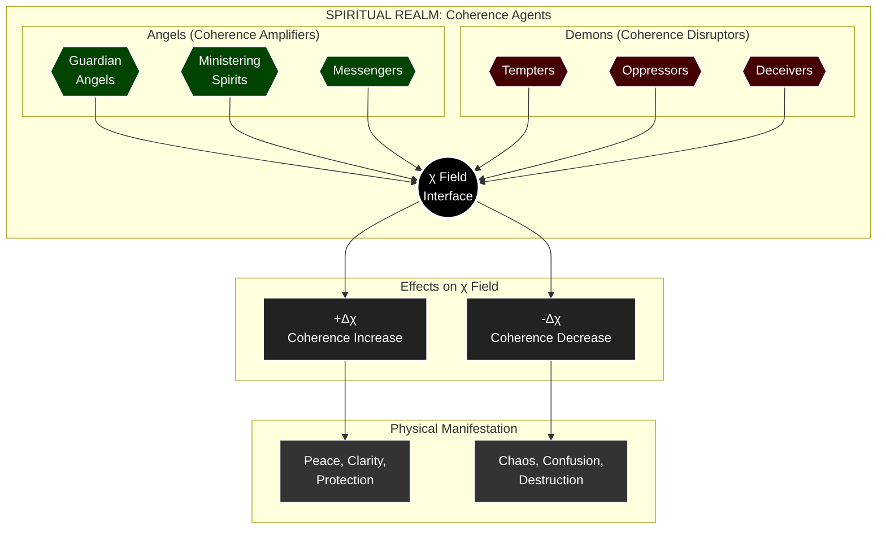
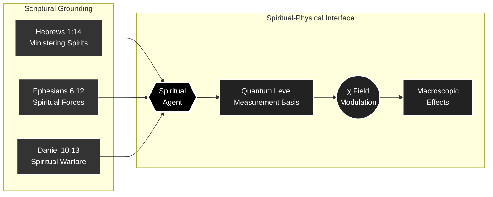

---
id: SC-067
phase: scaffolding
role: node
depends_on: []
authority: human
status: draft
---

# AX-067: Spiritual Axiom 67

**Chain Position:** 67 of 188  
**Domain:** Spiritual  
**Phase:** III

---

## Formal Statement

**Angelic Agency: Spiritual beings possess coherence-influencing agency — they can affect the χ field and thereby influence physical outcomes.**

Angels (and demons) are real agents within the Theophysics framework, operating as coherence modulators in the spiritual realm that interfaces with physical reality.

---

## Type Classification

**🟣 Theological** — Doctrine of angels applied to coherence theory

Spiritual beings are not metaphor or projection. They are genuine agents with causal efficacy, operating at a level of reality that interfaces with but is not reducible to physical processes.

---

## Derivation Path

**From AX-066:**

```
1. Spiritual realm is real (AX-066)
2. Realm contains agents (not just forces)
3. Agents have causal power (AX-014 applied)
4. Causal power operates through χ field
5. Therefore: spiritual beings influence coherence
∴ AX-067
```

Depends on: AX-066 (Spiritual Realm Reality)
Enables: AX-068 (Angelic Hierarchy), Grace transmission mechanisms

---

## Defeat Conditions

This axiom is falsified if:

1. **Spiritual realm completely isolated from physical**

   - Test: Show absolute causal closure of physical realm
   - Prediction: Coherence anomalies indicate spiritual causation
   - Status: 🟡 Debated - causal closure is assumption, not proven

2. **Spiritual beings have no agency**

   - Test: Show spiritual forces are impersonal
   - Prediction: Personal agency revealed in spiritual phenomena
   - Status: 🟡 Testable - exorcism, prayer effects

3. **All spiritual phenomena reduce to psychology**
   - Test: Explain all reported phenomena neurologically
   - Prediction: Irreducible cases exist
   - Status: 🟡 Open question

---

## Tier -1 Constraints

**DEF-VAR-009: Noether Current (J^μ_χ)**

- Angels can channel coherence current
- Demons disrupt current flow
- Spiritual warfare = current conflict

**DEF-VAR-010: Vacuum Expectation Value (⟨χ⟩₀)**

- Angels maintain baseline coherence
- Fallen angels degrade local coherence
- Prevenient Grace mediated by angelic action

---

## Trinity Mapping

**Person:** Spirit (Primarily) — Lord of the spiritual realm

**Theological Role:**
The Holy Spirit governs the spiritual realm. Angels are "ministering spirits" (Hebrews 1:14) sent by God. The Spirit directs angelic agency.

**Scripture:**

- **Hebrews 1:14**: "Are not all angels ministering spirits sent to serve?"
- **Psalm 103:20**: "Praise the Lord, you his angels, you mighty ones who do his bidding"
- **Ephesians 6:12**: "Our struggle is not against flesh and blood, but against... spiritual forces"
- **Daniel 10:13**: "The prince of the Persian kingdom resisted me" (spiritual warfare)

---

## Physical Grounding

**Coherence Theory:**

- Spiritual beings operate as coherence field modulators
- Angels amplify coherence (harmony, protection, guidance)
- Demons disrupt coherence (temptation, oppression, chaos)
- χ field serves as interface between spiritual and physical

**Quantum Interface:**

- Spiritual agency may operate at quantum level
- Measurement basis selection influenced by spiritual agents
- Observer effect as mechanism for spiritual causation

**Phenomenology:**

- Religious experiences correlate with coherence states
- Exorcism produces measurable psychological/physiological changes
- Prayer shows statistical effects in some studies

**Predictions:**

- **P-ANG-1**: Spiritual activity produces coherence anomalies
  - Status: 🟡 Testable - requires coherence field detection
- **P-ANG-2**: Places of worship show elevated coherence
  - Status: 🟡 Testable - sacred sites, churches, temples
- **P-ANG-3**: Demonic activity correlates with coherence degradation
  - Status: 🟡 Testable - locations of reported activity

**Cross-Domain Isomorphism:**

| Domain | Spiritual Agent Analog |
|--------|----------------------|
| Physics | Field operators |
| Computing | Background processes |
| Biology | Microbiome influence |
| Psychology | Subconscious agents |

**Transfer Principle:** Spiritual beings are to the spiritual realm what particles are to the physical — localized, agentive, causally efficacious entities that interact with the underlying field structure.

---

## Full Inheritance Chain

This axiom builds on **0 prior axioms**:

- None (Primitive axiom)

---

## What This Enables (Collapse Radius)

If this axiom fails, these axioms die:

- [[AX-068]]

---

## Dataview Queries

### Dependencies (What I Need)

```dataview
LIST
FROM "00_STRUCTURE/TIER_1"
WHERE contains(this.file.depends_on, file.name)
SORT chain_position ASC
```

### Dependents (What Needs Me)

```dataview
LIST
FROM "00_STRUCTURE/TIER_1"
WHERE contains(depends_on, this.file.name)
SORT chain_position ASC
```

---

## Status: 🟡 Template Generated

**Next Steps:**

1. Refine based on usage
2. Add empirical evidence
3. Specify defeat conditions
4. Enhance mathematical formulation

---

## Metadata

**Created:** 2025-12-30
**Version:** 1.0 (Template)
**Source:** Batch generated from INTEGRATED-AXIOM-MASTER.md

---

## Visual Diagram: Angelic Agency




