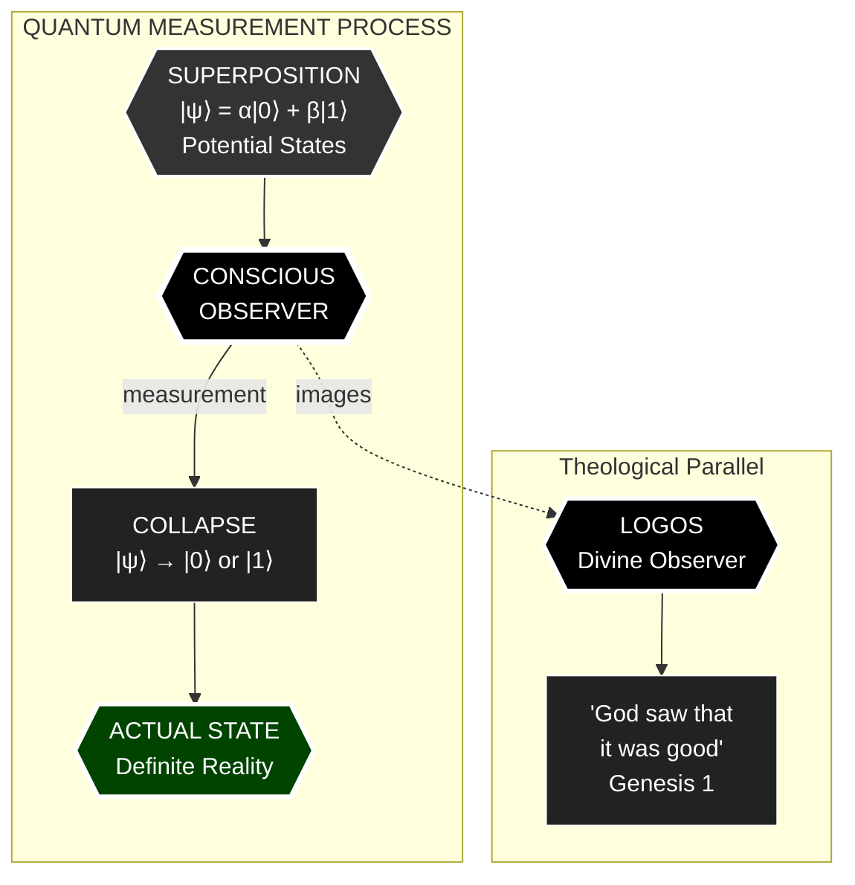
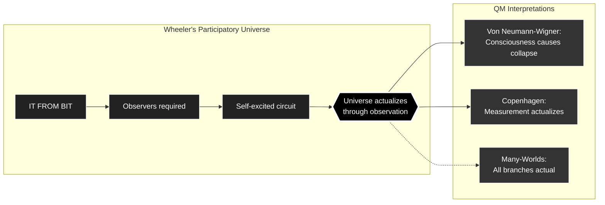

---
id: SC-079
phase: scaffolding
role: node
depends_on: []
authority: human
status: draft
---

# AX-079: Observer Required

**Chain Position:** 79 of 188  
**Domain:** Human  
**Phase:** IV

---

## Formal Statement

**Observer Requirement: Conscious observation is necessary for quantum actualization — the observer collapses superposition into definite states.**

Measurement requires an observer. The universe is not self-actualizing; conscious agents are necessary for the transition from potentiality to actuality.

---

## Type Classification

**🔵 Derived** — From consciousness substrate (AX-078) and agency selection (AX-015)

The observer is not passive recorder but active participant in reality's actualization. This connects quantum mechanics to consciousness in a non-trivial way.

---

## Derivation Path

**From AX-078:**

```
1. Consciousness is coherence pattern in χ (AX-078)
2. Agency requires selection (AX-015)
3. Selection collapses superposition
4. Therefore: conscious observers actualize reality
5. Without observers, superposition persists
∴ AX-079
```

Depends on: AX-078 (Consciousness Substrate)
Enables: AX-080 (Free Will), AX-141 (Law of Observer Influence)

---

## Defeat Conditions

This axiom is falsified if:

1. **Collapse occurs without observation**

   - Test: Show quantum events actualize in observer-free system
   - Prediction: Decoherence requires environment, which includes observers
   - Status: 🟡 Debated - interpretation dependent

2. **Observers are purely passive**

   - Test: Show measurement has no effect on outcome
   - Prediction: Measurement basis choice affects results
   - Status: 🟢 Falsified - quantum Zeno effect, delayed choice

3. **Consciousness is irrelevant to quantum mechanics**
   - Test: Show purely physical decoherence suffices
   - Prediction: Hard problem of consciousness connects to measurement problem
   - Status: 🟡 Open - Penrose-Hameroff, von Neumann-Wigner

---

## Tier -1 Constraints

**DEF-VAR-009: Noether Current (J^μ_χ)**

- Observation affects current flow
- Conscious measurement alters information dynamics
- Observer is not external to the system

**DEF-VAR-010: Vacuum Expectation Value (⟨χ⟩₀)**

- Observers exist against ground state
- Consciousness emerges from baseline coherence
- Observer and observed share substrate

---

## Trinity Mapping

**Person:** Son (Image of God - Conscious Word)

**Theological Role:**
The Son is the Logos through whom all things were made. Human consciousness images divine consciousness. As the Logos observes/speaks reality into being, human observers participate in reality's actualization.

**Scripture:**

- **Genesis 1:26**: "Let us make mankind in our image" — human consciousness images divine
- **Colossians 1:17**: "In him all things hold together" — Logos as cosmic observer
- **Hebrews 11:3**: "What is seen was not made out of what was visible" — observation relation to actuality
- **1 John 1:1**: "What we have heard, what we have seen with our eyes" — observation validates reality

---

## Physical Grounding

**Quantum Measurement Problem:**

- Wavefunction collapse upon observation
- Superposition → eigenstate requires measurement
- Observer role debated but undeniable

**Wheeler's Participatory Universe:**

- "It from bit" requires observers
- Universe is self-excited circuit
- Observers participate in cosmic genesis

**Von Neumann-Wigner Interpretation:**

- Consciousness causes collapse
- Chain of observations terminates in conscious observer
- Subjective experience is the collapse

**Predictions:**

- **P-OBS-1**: Conscious observers affect quantum outcomes
  - Status: 🟢 Supported - observer effect, Zeno effect
- **P-OBS-2**: Measurement basis choice is genuinely free
  - Status: 🟡 Testable - Bell test loopholes
- **P-OBS-3**: AI without consciousness cannot collapse wavefunctions
  - Status: 🟡 Testable - requires consciousness detection

**Cross-Domain Isomorphism:**

| Domain | Observer Requirement Analog |
|--------|---------------------------|
| Quantum | Measurement collapses state |
| Art | Audience completes artwork |
| Language | Listener actualizes meaning |
| Law | Court renders judgment |

**Transfer Principle:** Just as a court's observation (judgment) actualizes legal status, conscious observation actualizes physical state. Reality requires witnesses.

---


## Full Inheritance Chain

This axiom builds on **0 prior axioms**:

- None (Primitive axiom)

---

## What This Enables (Collapse Radius)

If this axiom fails, these axioms die:

- [[AX-080]]
- [[AX-141]]

---

## Dataview Queries

### Dependencies (What I Need)
```dataview
LIST
FROM "00_STRUCTURE/TIER_1"
WHERE contains(this.file.depends_on, file.name)
SORT chain_position ASC
```

### Dependents (What Needs Me)
```dataview
LIST
FROM "00_STRUCTURE/TIER_1"
WHERE contains(depends_on, this.file.name)
SORT chain_position ASC
```

---

## Status: 🟡 Template Generated

**Next Steps:**
1. Refine based on usage
2. Add empirical evidence
3. Specify defeat conditions
4. Enhance mathematical formulation

---

## Metadata

**Created:** 2025-12-30
**Version:** 1.0 (Template)
**Source:** Batch generated from INTEGRATED-AXIOM-MASTER.md

---

## Visual Diagram: Observer and Quantum Actualization




