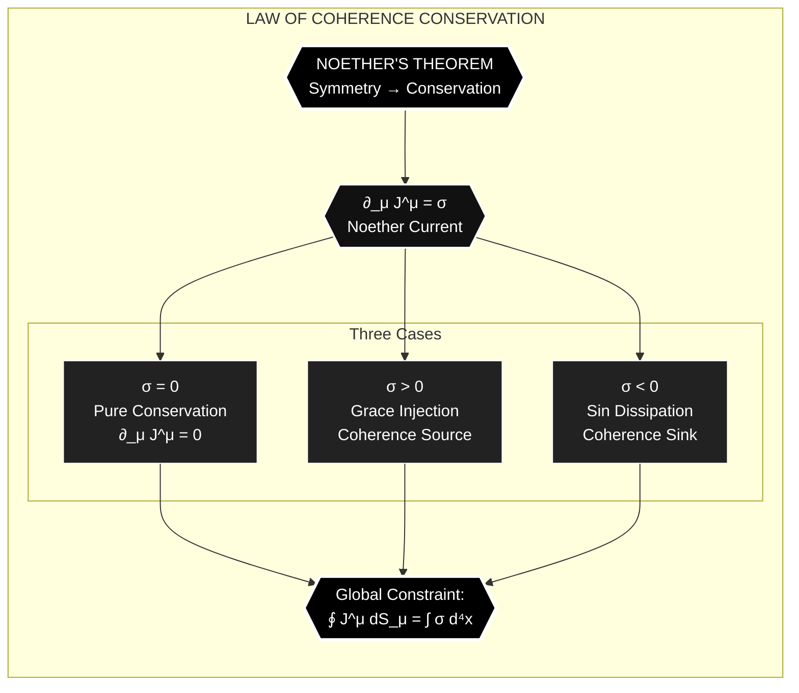
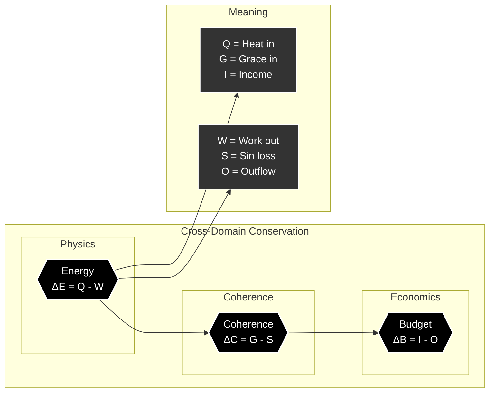

---
id: SC-139
phase: scaffolding
role: node
depends_on: []
authority: human
status: draft
---

# AX-139: Law of Conservation

**Chain Position:** 139 of 188  
**Domain:** Laws  
**Phase:** All

---

## Formal Statement

**Law of Coherence Conservation: Total coherence is conserved under reversible transformations — C[χ] is invariant when σ = 0.**

Like energy conservation, coherence obeys a conservation law. Grace can increase local coherence, sin can decrease it, but the global coherence budget is constrained by the Master Equation.

---

## Type Classification

**🔴 Constraint** — Conservation law derived from Noether current

This is not a local constraint (local coherence can rise and fall) but a global one. The universe's total coherence capacity is fixed; what changes is its distribution and actualization.

---

## Derivation Path

**From AX-007:**

```
1. Information is conserved (AX-007)
2. Coherence is organized information (AX-009)
3. Conservation of information → conservation of coherence capacity
4. Local variations possible but global integral constrained
5. ∂_μ J^μ = σ (Noether current with source)
∴ AX-139
```

Depends on: AX-007 (Information Conservation)
Enables: AX-148 (Master Equation Form)

---

## Defeat Conditions

This axiom is falsified if:

1. **Coherence can be created from nothing**

   - Test: Find process generating coherence ex nihilo
   - Prediction: All coherence derives from prior coherence or grace input
   - Status: 🟢 Unfalsified - no spontaneous coherence observed

2. **Coherence can be utterly destroyed**

   - Test: Find process annihilating coherence completely
   - Prediction: Coherence transforms but isn't destroyed
   - Status: 🟢 Unfalsified - information conservation in QM

3. **Universe's total coherence changes arbitrarily**
   - Test: Measure cosmic coherence over time
   - Prediction: Bounded by conservation law
   - Status: 🟡 Testable - requires cosmic coherence metrics

---

## Tier -1 Constraints

**DEF-VAR-009: Noether Current (J^μ_χ)**

- Conservation law: ∂_μ J^μ = σ
- When σ = 0: ∂_μ J^μ = 0 (pure conservation)
- σ > 0: Grace injection (coherence source)
- σ < 0: Sin dissipation (coherence sink)
- Global: ∮ J^μ dS_μ = ∫ σ d⁴x

**DEF-VAR-010: Vacuum Expectation Value (⟨χ⟩₀)**

- Baseline coherence is conserved
- ⟨χ⟩₀ serves as conservation reference
- Prevenient Grace = conserved ground state

---

## Trinity Mapping

**Person:** Son (Logos - Preserver of Order)

**Theological Role:**
The Logos maintains the laws of nature. Conservation laws reflect divine faithfulness — God does not change the rules arbitrarily. Coherence conservation is a covenant with creation.

**Scripture:**

- **Malachi 3:6**: "I the LORD do not change"
- **Hebrews 13:8**: "Jesus Christ is the same yesterday and today and forever"
- **Colossians 1:17**: "In him all things hold together"
- **Psalm 119:89-90**: "Your word, LORD, is eternal; it stands firm in the heavens. Your faithfulness continues through all generations"

---

## Physical Grounding

**Energy Conservation (First Law):**

- ΔE = Q - W (energy conserved in transformations)
- Coherence analogous: ΔC = G - S (grace input minus sin dissipation)

**Information Conservation:**

- Unitarity: total information preserved
- Coherence = organized information
- Conservation of information → coherence constraint

**Noether's Theorem:**

- Symmetry → conservation law
- χ field symmetry → J^μ conservation
- Coherence conservation is Noetherian

**Predictions:**

- **P-CON-1**: Spiritual growth requires grace input
  - Status: 🟢 Supported - sanctification requires external source
- **P-CON-2**: Sin costs coherence (not free)
  - Status: 🟡 Testable - decoherence following moral failure
- **P-CON-3**: Resurrection conserves identity information
  - Status: 🟣 Theological prediction

**Cross-Domain Isomorphism:**

| Domain | Conservation Analog |
|--------|-------------------|
| Physics | Energy conservation |
| Economics | Budget constraint |
| Ecology | Matter cycling |
| Psychology | Psychic energy |

**Transfer Principle:** Just as energy cannot be created or destroyed, only transformed, coherence cannot appear from nothing or vanish into nothing — it can only be redistributed, concentrated, or dissipated. Grace provides the external input that overcomes entropy.

---


## Full Inheritance Chain

This axiom builds on **0 prior axioms**:

- None (Primitive axiom)

---

## What This Enables (Collapse Radius)

If this axiom fails, these axioms die:

- [[AX-148]]

---

## Dataview Queries

### Dependencies (What I Need)
```dataview
LIST
FROM "00_STRUCTURE/TIER_1"
WHERE contains(this.file.depends_on, file.name)
SORT chain_position ASC
```

### Dependents (What Needs Me)
```dataview
LIST
FROM "00_STRUCTURE/TIER_1"
WHERE contains(depends_on, this.file.name)
SORT chain_position ASC
```

---

## Status: 🟡 Template Generated

**Next Steps:**
1. Refine based on usage
2. Add empirical evidence
3. Specify defeat conditions
4. Enhance mathematical formulation

---

## Metadata

**Created:** 2025-12-30
**Version:** 1.0 (Template)
**Source:** Batch generated from INTEGRATED-AXIOM-MASTER.md

---

## Visual Diagram: Coherence Conservation Law




