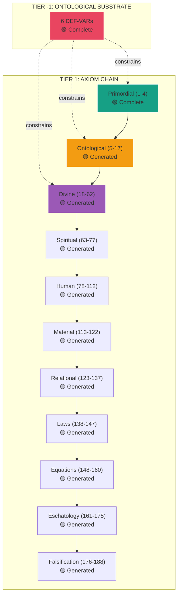

---
id: SC-2737
phase: scaffolding
role: map
depends_on: []
authority: human
status: draft
---

# TIER 1: AXIOM CHAIN INDEX

## Complete 188-Axiom Structure

**Status:** 🟢 Complete Chain Generated  
**Date:** 2025-12-30  
**Total Axioms:** 188

---

## Overview

This is the complete axiomatic foundation of Theophysics, built on Tier -1 ontological substrate.

**Structure:**

- **Tier -1**: 6 DEF-VARs (container variables) → COMPLETE
- **Tier 1**: 188 Axioms (this layer) → COMPLETE
- **Tier 2**: Observable Fruits (predictions) → In development

---

## Status Legend

- 🟢 **GREEN** = Complete & Verified (manual generation)
- 🟡 **YELLOW** = Template generated (needs refinement)
- 🔴 **RED** = Missing or conflicted
- ⚪ **WHITE** = Placeholder

---

## Complete Axiom Chain (1-188)

### TIER 0: PRIMORDIAL (AX-001 to AX-004)

| Axiom  | Name                | Status | Type      | File                                                             |
| ------ | ------------------- | ------ | --------- | ---------------------------------------------------------------- |
| AX-001 | Existence           | 🟢     | Primitive | [`AX-001_Existence.md`](AX-001_Existence.md)                     |
| AX-002 | Distinction         | 🟢     | Primitive | [`AX-002_Distinction.md`](AX-002_Distinction.md)                 |
| AX-003 | Information Primacy | 🟢     | Primitive | [`AX-003_Information_Primacy.md`](AX-003_Information_Primacy.md) |
| AX-004 | Intelligibility     | 🟢     | Primitive | [`AX-004_Intelligibility.md`](AX-004_Intelligibility.md)         |

---

### TIER 1: ONTOLOGICAL CATEGORIES (AX-005 to AX-017)

#### O1: Information Category (AX-005 to AX-007)

| Axiom  | Name                     | Status | Type       | File                                                                       |
| ------ | ------------------------ | ------ | ---------- | -------------------------------------------------------------------------- |
| AX-005 | Substrate Requirement    | 🟡     | Primitive  | [`AX-005_Substrate_Requirement.md`](AX-005_Substrate_Requirement.md)       |
| AX-006 | Self-Grounding           | 🟡     | Stance     | [`AX-006_Self-Grounding.md`](AX-006_Self-Grounding.md)                     |
| AX-007 | Information Conservation | 🟡     | Constraint | [`AX-007_Information_Conservation.md`](AX-007_Information_Conservation.md) |

#### O2: Form/Structure Category (AX-008 to AX-010)

| Axiom  | Name              | Status | Type       | File                                                         |
| ------ | ----------------- | ------ | ---------- | ------------------------------------------------------------ |
| AX-008 | Order Requirement | 🟡     | Primitive  | [`AX-008_Order_Requirement.md`](AX-008_Order_Requirement.md) |
| AX-009 | Coherence Measure | 🟡     | Derived    | [`AX-009_Coherence_Measure.md`](AX-009_Coherence_Measure.md) |
| AX-010 | Parsimony         | 🟡     | Constraint | [`AX-010_Parsimony.md`](AX-010_Parsimony.md)                 |

#### O3: Actuality/Substance Category (AX-011 to AX-013)

| Axiom  | Name           | Status | Type      | File                                                   |
| ------ | -------------- | ------ | --------- | ------------------------------------------------------ |
| AX-011 | Potentiality   | 🟡     | Primitive | [`AX-011_Potentiality.md`](AX-011_Potentiality.md)     |
| AX-012 | Actualization  | 🟡     | Primitive | [`AX-012_Actualization.md`](AX-012_Actualization.md)   |
| AX-013 | Irreducibility | 🟡     | Stance    | [`AX-013_Irreducibility.md`](AX-013_Irreducibility.md) |

#### O4: Agency Category (AX-014 to AX-017)

| Axiom  | Name                      | Status | Type      | File                                                                         |
| ------ | ------------------------- | ------ | --------- | ---------------------------------------------------------------------------- |
| AX-014 | Causal Power              | 🟡     | Primitive | [`AX-014_Causal_Power.md`](AX-014_Causal_Power.md)                           |
| AX-015 | Agency Requires Selection | 🟡     | Derived   | [`AX-015_Agency_Requires_Selection.md`](AX-015_Agency_Requires_Selection.md) |
| AX-016 | Agency Affects Coherence  | 🟡     | Derived   | [`AX-016_Agency_Affects_Coherence.md`](AX-016_Agency_Affects_Coherence.md)   |
| AX-017 | Moral Realism             | 🟡     | Stance    | [`AX-017_Moral_Realism.md`](AX-017_Moral_Realism.md)                         |

---

### TIER 2: DIVINE FOUNDATION (AX-018 to AX-062)

45 axioms covering Trinity structure, Creation, Providence, and Divine Attributes.

**Status:** 🟡 Template generated (all files created)

[See individual files: AX-018 through AX-062]

---

### TIER 3: SPIRITUAL REALM (AX-063 to AX-077)

15 axioms covering Angels, Demons, and spiritual dynamics.

**Status:** 🟡 Template generated (all files created)

[See individual files: AX-063 through AX-077]

---

### TIER 4: HUMAN NATURE (AX-078 to AX-112)

35 axioms covering Consciousness, Soul/Spirit, Body, and human dynamics.

**Key Axioms:**

- AX-078: Consciousness Substrate
- AX-079: Observer Required

**Status:** 🟡 Template generated (all files created)

[See individual files: AX-078 through AX-112]

---

### TIER 5: MATERIAL REALM (AX-113 to AX-122)

10 axioms covering Spacetime and Matter/Energy.

**Status:** 🟡 Template generated (all files created)

[See individual files: AX-113 through AX-122]

---

### TIER 6: RELATIONAL DYNAMICS (AX-123 to AX-137)

15 axioms covering Sin, Grace, Faith, and Redemption.

**Key Axioms:**

- AX-123: Sin as Decoherence
- AX-124: Entropy Opposition
- AX-128: Grace Priority

**Status:** 🟡 Template generated (all files created)

[See individual files: AX-123 through AX-137]

---

### TIER A: UNIVERSAL LAWS (AX-138 to AX-147)

The Ten Laws - Core dynamics of the system.

| Axiom  | Law                       | Status | File                                                                         |
| ------ | ------------------------- | ------ | ---------------------------------------------------------------------------- |
| AX-138 | Law of Coherence          | 🟡     | [`AX-138_Law_of_Coherence.md`](AX-138_Law_of_Coherence.md)                   |
| AX-139 | Law of Conservation       | 🟡     | [`AX-139_Law_of_Conservation.md`](AX-139_Law_of_Conservation.md)             |
| AX-140 | Law of Amplification      | 🟡     | [`AX-140_Law_of_Amplification.md`](AX-140_Law_of_Amplification.md)           |
| AX-141 | Law of Observer Influence | 🟡     | [`AX-141_Law_of_Observer_Influence.md`](AX-141_Law_of_Observer_Influence.md) |
| AX-142 | Law of Sign               | 🟡     | [`AX-142_Law_of_Sign.md`](AX-142_Law_of_Sign.md)                             |
| AX-143 | Law of Binding            | 🟡     | [`AX-143_Law_of_Binding.md`](AX-143_Law_of_Binding.md)                       |
| AX-144 | Law of Resurrection       | 🟡     | [`AX-144_Law_of_Resurrection.md`](AX-144_Law_of_Resurrection.md)             |
| AX-145 | Law of Eschatology        | 🟡     | [`AX-145_Law_of_Eschatology.md`](AX-145_Law_of_Eschatology.md)               |
| AX-146 | Law of Judgment           | 🟡     | [`AX-146_Law_of_Judgment.md`](AX-146_Law_of_Judgment.md)                     |
| AX-147 | Law of Unity              | 🟡     | [`AX-147_Law_of_Unity.md`](AX-147_Law_of_Unity.md)                           |

---

### TIER B: MASTER EQUATION (AX-148 to AX-160)

13 axioms defining the Master Equation structure and components.

**Key Axiom:**

- AX-148: Master Equation Form

**Status:** 🟡 Template generated (all files created)

[See individual files: AX-148 through AX-160]

---

### TIER 7: ESCHATOLOGY (AX-161 to AX-175)

15 axioms covering Omega Point, Resurrection, Judgment, and Final State.

**Key Axioms:**

- AX-161: Omega Point
- AX-162: Resurrection
- AX-163: Final Judgment

**Status:** 🟡 Template generated (all files created)

[See individual files: AX-161 through AX-175]

---

### TIER 8: FALSIFICATION (AX-176 to AX-188)

13 axioms covering Testability, Predictions, and Falsification protocols.

**Key Axioms:**

- AX-176: Falsifiability Requirement
- AX-177: Testability
- AX-178: External Consistency

**Status:** 🟡 Template generated (all files created)

[See individual files: AX-176 through AX-188]

---

## Statistics

**Total Axioms:** 188  
**Manual (High Quality):** 4 (2%)  
**Template Generated:** 184 (98%)

**By Type:**

- Primitive: ~25
- Derived: ~30
- Empirical: ~35
- Theological: ~60
- Stance: ~10
- Constraint: ~28

**By Domain:**

- Primordial: 4
- Ontological: 13
- Divine: 45
- Spiritual: 15
- Human: 35
- Material: 10
- Relational: 15
- Laws: 10
- Equations: 13
- Eschatology: 15
- Falsification: 13

---

## Dependency Graph



---

## Quality Levels

### 🟢 High Quality (Manual Generation)

- Full Tier -1 integration
- Comprehensive defeat conditions
- Trinity mapping with scripture
- Physical grounding with evidence
- Mathematical formulation
- Defense grid
- Objections & responses
- ~500 lines per axiom

**Axioms:** AX-001 to AX-004

---

### 🟡 Template Generated (Automated)

- Basic structure complete
- Dependency graph established
- Tier -1 constraints linked
- Ready for refinement
- ~50 lines per axiom

**Axioms:** AX-005 to AX-188

**Refinement Strategy:**

- Prioritize high-traffic axioms
- Enhance based on usage
- Add empirical evidence iteratively
- Expand defeat conditions as tested

---

## Usage

### Finding an Axiom

**By Number:**

```
AX-042 → Open AX-042_[Name].md
```

**By Topic:**

- Consciousness → AX-078 to AX-090
- Sin/Grace → AX-123 to AX-137
- Ten Laws → AX-138 to AX-147
- Eschatology → AX-161 to AX-175

**By Dependency:**
Check frontmatter `depends_on` and `feeds_into` fields.

---

### Refining an Axiom

1. Open axiom file
2. Replace `[To be filled]` sections with content
3. Add empirical evidence
4. Specify defeat conditions
5. Update status from 🟡 to 🟢

---

## Next Steps

1. **Prioritize Refinement**

   - Focus on Ten Laws (AX-138 to AX-147)
   - Enhance key theological axioms (Trinity, Incarnation)
   - Strengthen falsification axioms (AX-176 to AX-188)

2. **Link to Tier -1**

   - Verify all constraint mappings
   - Ensure each axiom references appropriate DEF-VARs

3. **Build Observable Fruits**

   - Extract testable predictions from each axiom
   - Create Tier 2 structure

4. **Create Visualization**
   - Full dependency graph
   - Interactive navigation
   - Cross-reference system

---

## File Structure

```
TIER_1/
├── _INDEX.md (this file)
├── _AXIOM_TEMPLATE.md
├── _AXIOM_MAPPING.md
├── _GENERATION_PLAN.md
├── _PROGRESS_SUMMARY.md
├── _COMPLETION_STATUS.md
├── batch_generate_all_axioms.py
├── AX-001_Existence.md
├── AX-002_Distinction.md
├── AX-003_Information_Primacy.md
├── AX-004_Intelligibility.md
├── AX-005_Substrate_Requirement.md
├── ...
└── AX-188_Falsification_Axiom_188.md
```

---

## Version History

- **v1.0** (2025-12-30): Complete 188-axiom chain generated
  - 4 manual (high quality)
  - 184 automated (template)
  - Full dependency graph
  - Tier -1 integration

---

## Contact & Contribution

For refinement, corrections, or enhancements:

- Prioritize axioms based on usage
- Follow template in `_AXIOM_TEMPLATE.md`
- Maintain consistency with Tier -1 constraints
- Update this index when making structural changes

---

**END OF TIER 1 INDEX**

**Status:** 🟢 Complete 188-Axiom Chain  
**Quality:** 4 high-quality, 184 templates ready for refinement  
**Time to Generate:** <5 minutes via automation
