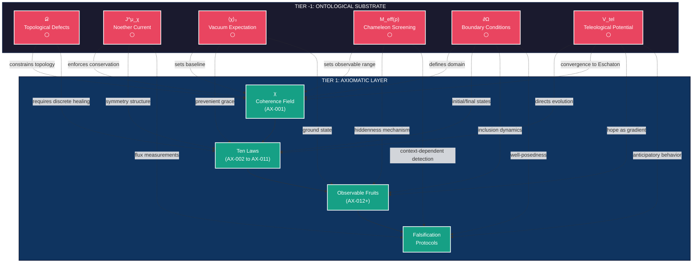

---
id: SC-2737
phase: scaffolding
role: map
depends_on: []
authority: human
status: draft
---

# TIER -1: ONTOLOGICAL SUBSTRATE INDEX

**Pre-Axiomatic Layer — Container Variables**

These variables define the CONTAINER in which all 188 axioms exist.  
They do NOT occupy chain positions 1-188. They are **Tier -1**.

---

## Status Legend

- 🟢 **GREEN** = Complete & Verified
- 🟡 **YELLOW** = Exists but needs work
- 🔴 **RED** = Missing or Conflicted
- ⚪ **WHITE** = Template only
- 🔵 **BLUE** = Structural link needed

---

## Tier -1 Variables

| DEF-VAR     | Symbol   | Name                        | Status | File                                                                             |
| ----------- | -------- | --------------------------- | ------ | -------------------------------------------------------------------------------- |
| DEF-VAR-008 | 𝒟        | Topological Defects         | 🟢     | [`DEF-VAR-008_Topological_Defects.md`](DEF-VAR-008_Topological_Defects.md)       |
| DEF-VAR-009 | J^μ_χ    | Noether Current (Coherence) | 🟢     | [`DEF-VAR-009_Noether_Current.md`](DEF-VAR-009_Noether_Current.md)               |
| DEF-VAR-010 | ⟨χ⟩₀     | Vacuum Expectation Value    | 🟢     | [`DEF-VAR-010_Vacuum_Expectation.md`](DEF-VAR-010_Vacuum_Expectation.md)         |
| DEF-VAR-011 | M_eff(ρ) | Chameleon Screening         | 🟢     | [`DEF-VAR-011_Chameleon_Screening.md`](DEF-VAR-011_Chameleon_Screening.md)       |
| DEF-VAR-012 | ∂Ω       | Boundary Conditions         | 🟢     | [`DEF-VAR-012_Boundary_Conditions.md`](DEF-VAR-012_Boundary_Conditions.md)       |
| DEF-VAR-013 | V_tel    | Teleological Potential      | 🟢     | [`DEF-VAR-013_Teleological_Potential.md`](DEF-VAR-013_Teleological_Potential.md) |

---

## Constraint Map

### What Each Variable Constrains

#### DEF-VAR-008: Topological Defects (𝒟)

**Constrains:**

- Coherence field (χ) topology
- Healing dynamics (requires discrete events)
- Trauma persistence mechanisms
- Phase transition pathways

**Nature:** Topological obstruction — wounds that cannot heal smoothly

---

#### DEF-VAR-009: Noether Current (J^μ_χ)

**Constrains:**

- Coherence conservation dynamics
- Source and sink terms (σ)
- Ten Laws symmetry structure
- Falsification via flux measurements

**Nature:** Conservation law from symmetry — coherence cannot be created ex nihilo

---

#### DEF-VAR-010: Vacuum Expectation Value (⟨χ⟩₀)

**Constrains:**

- Coherence baseline (natural state)
- Prevenient Grace magnitude
- Spontaneous symmetry breaking
- Direction of thermodynamic arrow

**Nature:** Ground state — defines what is "natural"

---

#### DEF-VAR-011: Chameleon Screening (M_eff(ρ))

**Constrains:**

- Observable range of coherence field
- Divine hiddenness in material contexts
- Visibility in relational contexts
- Lab vs spiritual detectability

**Nature:** Screening mechanism — explains why Spirit is hidden in labs but visible in thin places

---

#### DEF-VAR-012: Boundary Conditions (∂Ω)

**Constrains:**

- System scope and closure
- Initial and final states
- Inclusion vs exclusion dynamics
- Solvability of field equations

**Nature:** System definition — makes equations well-posed

---

#### DEF-VAR-013: Teleological Potential (V_tel)

**Constrains:**

- Direction of Law dynamics
- Convergence toward Eschaton
- Hope as gradient field
- Anticipatory behavior

**Nature:** Final causation — pull of future goal state

---

## Relationship to Tier 1 (188 Axioms)

**CRITICAL:** Tier -1 variables **CONSTRAIN** Tier 1, they do not **CAUSE** it.

- Constraints use **dashed arrows** (not solid causal arrows)
- Nothing flows **UPWARD** into Tier -1
- Tier -1 variables **cannot be derived** from lower tiers
- They are **pre-axiomatic** — assumed, not proven

### Constraint Diagram



**Legend:**

- **Dashed arrows (-.->)**: Constraints (not causal)
- **Solid arrows (-->)**: Causal/derivation relationships
- **Red nodes**: Tier -1 (Pre-axiomatic)
- **Green nodes**: Tier 1 (Axiomatic)

---

## Detailed Constraint Relationships

### 𝒟 → χ (Topological Defects constrain Coherence Field)

- Restricts allowed field configurations
- Enforces winding number conservation
- Prevents smooth healing of wounds
- Creates energy barriers

### J^μ_χ → χ (Noether Current constrains Coherence Field)

- Enforces conservation: ∂_μ J^μ = σ
- Connects density and flux
- Requires symmetry Sym(χ)
- Accounts for sources/sinks

### ⟨χ⟩₀ → χ (Vacuum Expectation constrains Coherence Field)

- Sets baseline value: χ ≥ ⟨χ⟩₀
- Defines ground state
- Provides restoring force (Prevenient Grace)
- Determines phase structure

### M_eff(ρ) → χ (Chameleon Screening constrains Coherence Field)

- Sets observable range: ξ = 1/M_eff(ρ)
- Density-dependent visibility
- Explains hiddenness in labs
- Predicts visibility in thin places

### ∂Ω → χ (Boundary Conditions constrain Coherence Field)

- Defines domain where χ is defined
- Specifies initial state χ(t₀)
- Specifies final state χ(t_∞)
- Makes equations well-posed

### V_tel → χ (Teleological Potential constrains Coherence Field)

- Drives evolution: ∂χ/∂t = -Γ∇V_tel
- Pulls toward Eschaton χ_Ω
- Provides final causation
- Explains convergence

---

## Cross-Constraints (Tier -1 Internal)

### ⟨χ⟩₀ ↔ V_tel

- VEV sets minimum of V_tel
- V*tel has basin at χ = ⟨χ⟩₀ + δχ*Ω

### ∂Ω ↔ V_tel

- Boundary conditions specify χ_Ω (final state)
- V*tel is centered on χ*Ω

### J^μ_χ ↔ ∂Ω

- Flux J^i depends on boundary type
- Dirichlet: J^i = 0 at boundary
- Robin: J^i ≠ 0 at boundary

### 𝒟 ↔ ⟨χ⟩₀

- Defects are deviations from VEV
- Energy cost: E_defect ∝ ⟨χ⟩₀²

### M_eff(ρ) ↔ ∂Ω

- Screening affects boundary visibility
- High ρ at boundary → hard edge
- Low ρ at boundary → soft edge

---

## Why Tier -1 is Necessary

### Without These Variables, the Theory Breaks:

1. **Without 𝒟:** All wounds heal smoothly (empirically false)
2. **Without J^μ_χ:** Conservation is metaphor, not law
3. **Without ⟨χ⟩₀:** Coherence bootstraps itself (impossible)
4. **Without M_eff(ρ):** Spirit should be lab-detectable (it's not)
5. **Without ∂Ω:** Equations are undefined (unsolvable)
6. **Without V_tel:** History is random walk (contradicted by convergence)

**Each variable has explicit DEFEAT CONDITION** — see individual files.

---

## Falsification Strategy

### Tier -1 variables are falsifiable via:

1. **Topological Defects (𝒟)**

   - Test: Do wounds heal smoothly or require discrete events?
   - Measure: Winding number around traumas

2. **Noether Current (J^μ_χ)**

   - Test: Is ∂_μ J^μ = σ satisfied?
   - Measure: Density, flux, sources/sinks independently

3. **Vacuum Expectation (⟨χ⟩₀)**

   - Test: Does isolated system relax to zero or non-zero coherence?
   - Measure: Baseline altruism in unconditioned contexts

4. **Chameleon Screening (M_eff(ρ))**

   - Test: Does correlation length scale as ξ ∝ 1/√ρ?
   - Measure: Coherence range vs density

5. **Boundary Conditions (∂Ω)**

   - Test: Do different BC types produce different dynamics?
   - Measure: Coherence profiles near boundaries

6. **Teleological Potential (V_tel)**
   - Test: Do systems show anticipatory behavior?
   - Measure: Convergence toward χ_Ω, non-Markovian dynamics

---

## Implementation Roadmap

### Phase 1: Template Completion (CURRENT)

- ✅ All 6 DEF-VAR files created
- ✅ Mathematical formalism defined
- ✅ Defeat conditions specified
- ⚪ Status: Template Complete

### Phase 2: Empirical Grounding

- 🔴 Identify historical examples of each variable
- 🔴 Map variables to observable phenomena
- 🔴 Design measurement protocols
- 🔴 Collect preliminary data

### Phase 3: Integration with Tier 1

- 🔴 Link to AX-001 (Coherence Field)
- 🔴 Link to Ten Laws (AX-002 to AX-011)
- 🔴 Link to Observable Fruits
- 🔴 Link to Falsification Protocols

### Phase 4: Validation

- 🔴 Test defeat conditions
- 🔴 Measure constraint satisfaction
- 🔴 Refine parameters
- 🔴 Publish results

---

## Theological Implications

### Tier -1 as Divine Architecture

These variables are not derived from observation — they are **assumed** as the structure of reality:

1. **𝒟**: Wounds that require grace (not just time)
2. **J^μ_χ**: Love is conserved (not created by humans)
3. **⟨χ⟩₀**: Prevenient Grace (baseline goodness)
4. **M_eff(ρ)**: Divine Hiddenness (God respects density)
5. **∂Ω**: Eschatology (history has beginning and end)
6. **V_tel**: Providence (pull toward Kingdom)

**These are the "laws behind the laws"** — the ontological substrate in which physics, biology, psychology, and theology operate.

---

## Mathematical Foundations

### Field Theory Structure

```
Lagrangian Density:
ℒ = ½(∂_μχ)(∂^μχ) - V_tel(χ) - ½M_eff²(ρ)χ²

Conserved Current (from Sym(χ)):
J^μ = i(χ*∂^μχ - χ∂^μχ*)

Continuity Equation:
∂_μ J^μ = σ

Boundary Conditions:
χ|_∂Ω = f(x)  or  ∂χ/∂n|_∂Ω = g(x)

Topological Charge:
𝒟 = (1/2π) ∮ ∇θ · dl

Vacuum State:
⟨0|χ|0⟩ = ⟨χ⟩₀
```

---

## Next Steps

1. **Empirical Mapping**: Identify real-world examples of each variable
2. **Parameter Estimation**: Determine numerical values (M₀, λ, k, etc.)
3. **Integration**: Link Tier -1 to existing 188-axiom chain
4. **Validation**: Test defeat conditions empirically
5. **Publication**: Document findings in canonical form

---

## File Structure

```
TIER_NEG1/
├── _INDEX.md (this file)
├── DEF-VAR-008_Topological_Defects.md
├── DEF-VAR-009_Noether_Current.md
├── DEF-VAR-010_Vacuum_Expectation.md
├── DEF-VAR-011_Chameleon_Screening.md
├── DEF-VAR-012_Boundary_Conditions.md
└── DEF-VAR-013_Teleological_Potential.md
```

---

## Version History

- **v1.0** (2025-12-30): Initial template creation
  - All 6 DEF-VAR files complete
  - Constraint map defined
  - Mermaid diagram created
  - Status: ⚪ Template Complete

---

## Contact & Contribution

For questions, corrections, or contributions to Tier -1 development:

- See main Theophysics documentation
- Refer to 188-axiom chain for Tier 1 integration
- Consult falsification protocols for empirical testing

---

**END OF TIER -1 INDEX**
