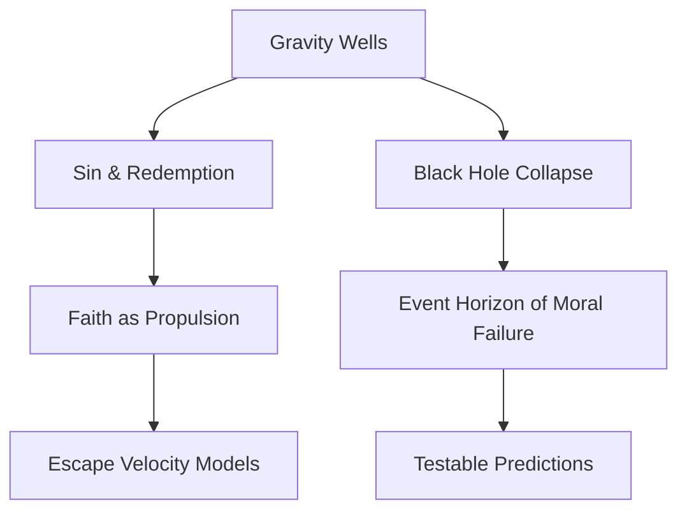

---
id: MO-2357
phase: motion
role: meta
depends_on: []
authority: human
status: draft
---

# **Law 1: Comprehensive Keyword & Concept Map**   
   
## **📜 Connection-Generating Framework for Law 1**   
   
### **🔗 Concept Bridge for Law 1: Gravity, Sin, and the Struggle to Rise**   
   
**Core Connection:**   
   
   
- **Physical Principle**: **Gravity** exerts a downward force, requiring energy to overcome.   
- **Spiritual Parallel**: **Sin & Fallen Nature** exert downward tendencies on the soul, requiring spiritual effort to transcend.   
- **Mathematical Expression**: F = G rac{m_1 m_2}{r^2} (Newton’s Law of Universal Gravitation), representing the force that binds bodies toward a central mass.   
   
**Connection Strength:**   
   
   
- **Direct Evidence**: Just as overcoming gravity requires **escape velocity**, overcoming sin requires **spiritual propulsion** (grace, faith, discipline).   
- **Inferential Evidence**: The struggle against **entropy & decay** in thermodynamics mirrors the **spiritual struggle** against moral decline.   
- **Predictive Power**: If **spiritual growth follows gravitational escape models**, this could predict thresholds of faith endurance.   
   
**Bidirectional Insights:**   
   
   
- **Physics → Spirituality**: The **gravitational well** mirrors the difficulty of escaping spiritual bondage.   
- **Spirituality → Physics**: Theological doctrines of **ascension, resurrection, and enlightenment** align with concepts of gravitational defiance.   
   
**Related Laws:**   
   
   
- Primary: **[[Law 1: Gravity, Sin, and the Struggle to Rise]]**   
- Secondary: **[[Law 2: Nuclear Force & Unity]], [[Law 5: Entropy & Free Will]]**   
   
**Open Questions:**   
   
   
- Is **gravitational resistance a fractal metaphor** for spiritual struggle at all levels of existence?   
- Can **black hole event horizons** be modeled as spiritual points of no return (i.e., moral collapse)?   
   
**Research Directions:**   
   
   
- **Spiritual Energy Escape Velocity**: Can faith or enlightenment be **mathematically modeled** like planetary escape?   
- **Black Hole Theology**: Studying moral failure as an irreversible event horizon.   
   
   
---   
   
### **📊 Cross-Disciplinary Analysis for Law 1**   
   
**Disciplinary Perspectives:**   
   
   
- **Physics**: Newtonian & Relativistic Gravity, Black Holes, Thermodynamics.   
- **Theology**: Original Sin, Grace, Redemption, Striving for Higher Consciousness.   
- **Philosophy**: Free Will vs. Determinism, The Struggle for Virtue.   
- **Mathematics**: Differential Equations for Gravity & Resistance.   
   
**Harmony Analysis:**   
   
   
- **Areas of Agreement**: Both gravity and sin **exert downward pulls**, requiring external effort to overcome.   
- **Apparent Contradictions**: Physical gravity is deterministic, while **spiritual gravity allows free will.**   
- **Synthesis Opportunities**: Investigating whether **spiritual breakthroughs follow gravitational escape models.**   
   
**Dimensional Analysis:**   
   
   
- **Physical Dimension**: Gravity governs planetary, cosmic, and quantum-scale interactions.   
- **Informational Dimension**: Sin and entropy **increase disorder**, requiring structured inputs for recovery.   
- **Consciousness Dimension**: Higher states of awareness **mirror escape from cognitive gravity.**   
- **Spiritual Dimension**: The soul’s struggle is **a gravitational climb toward divine presence.**   
   
**Integration Model:**   
   
   
- **Proposed Framework**: The process of redemption **mirrors the physics of gravitational escape.**   
- **Mathematical Model**: Escape velocity equations applied to theological effort.   
- **Testable Elements**: Studying persistence in faith through the lens of resistance models.   
   
**Connected Concepts:**   
   
   
- [[Sin & Gravitational Wells]]   
- [[Black Hole Theology]]   
- [[Redemption as Escape Velocity]]   
   
   
---   
   
### **🚀 Radical Hypothesis for Law 1**   
   
**The Wild Idea:**   
   
   
- **Moral and spiritual ascension follow the same resistance curves as gravity wells and planetary escape.**   
   
**Conventional Understanding:**   
   
   
- Sin is purely a moral concept, while gravity is purely physical.   
   
**The Paradigm Shift:**   
   
   
- If **spiritual ascent follows a mathematically predictable path**, we could create a **spiritual mechanics model** for moral progress.   
   
**Potential Implications:**   
   
   
- **For Physics**: Could introduce **metaphysical gravity fields** in complex systems.   
- **For Theology**: Suggests a **unified struggle principle** across disciplines.   
- **For Consciousness**: Could predict spiritual awakening thresholds.   
- **For Humanity**: May refine **progressive effort models** for overcoming adversity.   
   
**Supporting Patterns:**   
   
   
- [[Quantum Gravity & Spiritual Forces]]   
- [[Moral Resistance as a Frictional Force]]   
- [[Time Dilation in Sin States]]   
   
**Thought Experiments:**   
   
   
- Do individuals who overcome deep moral struggles **follow exponential resistance decline models** (like breaking escape velocity)?   
- Can **moral failure black holes be reversed**, or do they have true event horizons?   
   
**Integration with Laws:**   
   
   
- [[Law 2: Nuclear Force & Unity]] → Gravity resists binding force, requiring nuclear-level cohesion.   
- [[Law 3: Light & Truth]] → Photons escape gravity wells, paralleling **truth breaking through deception.**   
- [[Law 5: Entropy & Free Will]] → Gravity (sin) increases entropy, requiring structured effort for reversal.   
   
   
---   
   
## **🏷 Tag System for Law 1 Research Files**   
   
   
- `#gravity` - Newtonian, Relativistic, Black Holes.   
- `#sin` - Moral Fall, Original Sin, Redemption Struggle.   
- `#escape-velocity` - Spiritual Effort Models.   
- `#entropy` - Sin & Disorder Relationship.   
- `#thermodynamics` - The Heat Death of Moral Systems.   
- `#black-hole-theology` - Irreversibility of Moral Collapse.   
- `#experiment` - Faith Persistence Studies.   
- `#direct-parallel` - Gravity ↔ Sin.   
- `#creative-leap` - Quantum Gravity ↔ Spiritual Mechanics.   
   
   
---   
   
## **🔗 Connection Tracking System for Law 1**   
   
### **Physics → Spirituality Connections**   
   
|Physics Concept|Spiritual Concept|Connection Strength|Primary Law|Notes|   
|---|---|---|---|---|   
|Gravity Wells|Sin & Moral Weight|Strong|[[ZZZ/Law 1 1]]|Harder to escape deeper moral failure|   
|Black Holes|Irreversible Spiritual Collapse|Medium|[[ZZZ/Law 1 1]], [[ZZZ/Law 5]]|Point of no return in moral failure|   
|Escape Velocity|Redemption & Effort|Strong|[[ZZZ/Law 1 1]], [[1 Faith with Physics/Law 2 Folder/Law 2/Law 2 Meta]]|Minimum effort required for breakthrough|   
   
### **Spirituality → Physics Insights**   
   
|Spiritual Concept|Physics Insight|Validation Status|Primary Law|Notes|   
|---|---|---|---|---|   
|Grace as Propulsion|Escape Velocity Boost|Hypothetical|[[ZZZ/Law 1 1]]|Faith provides an external lift force|   
|Sin as Gravity|Entropy Increase|Testable|[[ZZZ/Law 5]]|Modeled through resistance curves|   
|Faith as Light|Photon Escape from Gravity Wells|Emerging|[[Laws E/10_Laws/Law_01_Gravity_Sin/Law 3 Light]]|Truth’s ability to escape deception|   
   
   
---   
   
## **📊 Visualization Framework**   
   
### **Concept Network for Law 1**   
   

   
   
   
---   
   
This will **slot directly into your Obsidian map**, letting you see **Law 1’s deep connections with Law 2 and beyond.** 🚀 Let me know what refinements or expansions you need!   
`{_obsidian_pattern_tag_Law-1Folder}`   
##strong-nuclear-force   
##gravity-law   
##electromagnetism   
##weak-force   
##unified-field-theory   
##observer-effect   
##quantum-entanglement   
##wavefunction-collapse   
##uncertainty-principle   
##Schrodinger-equation   
##time-dilation   
##spacetime-curvature   
##relativity   
##causality   
##eternal-perspective   
##entropy   
##Shannon-information   
##thermodynamics   
##fractal-order   
##computational-reality   
##quark-binding   
##nuclear-binding-energy   
##gluons   
##stability-equations   
##divine-unity   
##faith-cohesion   
##spiritual-entropy   
##covenantal-strength   
##divine-resonance   
##spiritual-connection   
##prayer-synchronization   
##quantum-prayer   
##nonlocal-consciousness   
##neural-faith-model   
##eternal-perspective   
##free-will   
##predestination-paradox   
##timeless-consciousness   
##God-outside-time   
##faith-physics   
##soul-quantization   
##spiritual-binding   
##sacred-geometry   
##fractal-theology   
##moral-collapse   
##sin-entropy   
##grace-energy   
##redemptive-force   
##divine-law   
##logos   
##biblical-resonance   
##Pauline-systematics   
##revelation-theory   
##scripture-synchronization   
##quantum-faith   
##spiritual-superposition   
##wavefunction-choice   
##conscious-collapse   
##moral-duality   
##divine-information   
##theological-chromodynamics   
##prayer-electromagnetism   
##faith-field-theory   
##divine-bond   
##nuclear-theology   
##theological-magic-numbers   
##covenant-physics   
##spiritual-entropy   
##thermodynamic-grace   
##sin-increasing-disorder   
##grace-negentropy   
##multi-layered-reality   
##soul-wavefunction   
##prayer-beyond-time   
##higher-dimensional-God