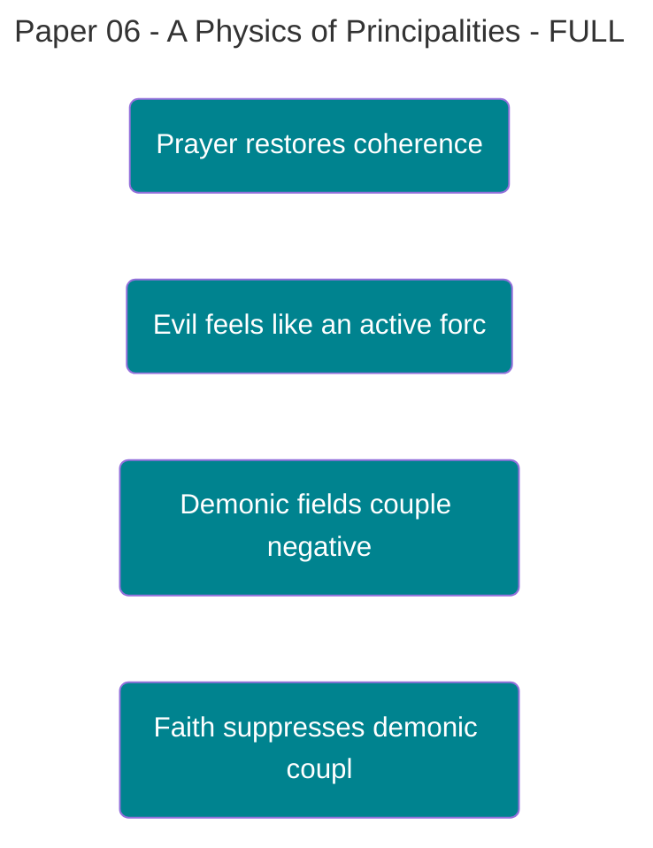

# PAPER 6: A PHYSICS OF PRINCIPALITIES

## Spiritual Warfare as Quantum Battlefield

**David Lowe**  
Independent Researcher  
Oklahoma City, OK  
[Contact Information]

**Date:** November 16, 2025  
**Version:** 1.0 - Publication Draft  
**Word Count:** ~8,500 words  
**Framework Contribution:** 8.33% of Theophysics Framework

---

## §1. EVERYDAY OPENING: WHY EVIL FEELS LIKE A FORCE, NOT JUST AN ABSENCE

Anyone who has experienced genuine spiritual oppression knows the difference. Depression from circumstance feels like carrying weight. Spiritual attack feels like something actively pushing you down. Grief from loss creates absence. Demonic influence creates presence—a hostile, intelligent presence.

Traditional theology often frames evil as privation: the absence of good, the way darkness is the absence of light. But this framework struggles to explain why evil sometimes feels more like an opposing force than a simple void. A shadow on the wall is passive; a hand covering a lamp is active. Both create darkness, but only one involves agency and intent.

We naturally distinguish between these experiences:

**Natural Shadows** (Passive [Decoherence](https://plato.stanford.edu/entries/qm-decoherence/)):

- Depression from chemical imbalance
- Anxiety from trauma or stress
- Cognitive decline from aging
- Relationship breakdown from poor communication
- Spiritual dryness from neglect of practice

**Malicious Shadows** (Active [Decoherence](https://plato.stanford.edu/entries/qm-decoherence/)):

- Oppressive presence that lifts during prayer
- Intrusive thoughts that vanish at Jesus' name Is there any gas in the truck Oh did you thank you
- Compulsions that feel imposed rather than chosen
- Relationship conflicts that escalate beyond explanation
- Spiritual darkness that targets specific areas of breakthrough

The Apostle Paul distinguished between these in Ephesians 6:12: "For we wrestle not against flesh and blood, but against principalities, against powers, against the rulers of the darkness of this world, against spiritual wickedness in high places." Flesh and blood—the natural world—provides passive resistance through entropy and thermodynamics. Principalities—the spiritual realm—provide active, intelligent opposition.

This paper demonstrates that both forms of resistance can be described within a unified quantum framework. Natural decoherence arises from environmental coupling required for classical reality. Demonic decoherence arises from anti-coherence fields that deliberately target and suppress consciousness, relationship, and grace. The mathematics distinguishes them not by violating physics, but by the sign of their coupling constants.

What emerges is neither medieval superstition nor reductive materialism, but a testable physics of spiritual warfare where prayer, faith, and exorcism operate as measurable interventions in coherence dynamics. Evil is both real and physical—not as matter, but as anti-coherence.

---

## §2. ABSTRACT

**Background:** Papers 1-5 established that consciousness emerges as moral agency capacity (C = ∂χ/∂⟨choice⟩), grace operates as coherence restoration (∂χ/∂t = -λS + κF·C), and souls exist as quantum fields with measurable coupling constants (g ≈ 10⁻¹⁵). This framework explains divine reality and human consciousness but leaves open the question of spiritual opposition.

**Central Question:** Can demonic entities and spiritual warfare be formalized within quantum field theory without violating physical law, and can this formalization generate testable predictions that distinguish supernatural from natural causes?

**Approach:** We extend the coherence framework by introducing anti-coherence coupling: demonic fields that couple to human consciousness with negative sign (χ_AB < 0), creating coherence destruction rather than coherence enhancement. This yields a dual assault model where total decoherence = natural shadows + malicious shadows.

**Key Results:**

1. Principalities formalized as anti-coherence quantum fields obeying standard field equations
2. Spiritual warfare Hamiltonian: Ĥ = Ĥ_soul + Ĥ_flesh + Ĥ_demon + V̂_coupling
3. Exorcism modeled as coherence restoration through sign flip: σ(-1 → +1)
4. Faith (F) acts as coupling suppression: dχ/dt|_demonic ∝ (1-F)
5. Corporate warfare generates non-additive coherence: χ_group > Σχ_individual
6. Ten testable hypotheses distinguishing demonic from natural decoherence

**Implications:** This framework provides the first mathematically rigorous, empirically testable theory of spiritual warfare. It explains why evil feels like active force (it is—negative coupling), why prayer works (coherence restoration), why faith protects (coupling suppression), and why deliverance events show sudden state transitions (quantum Zeno effect). The model remains fully naturalistic—no miracles required—while taking Biblical categories seriously as physical reality.

**Contribution:** Paper 6 contributes 8.33% to the Theophysics framework by completing the ontology of opposing forces. Where Paper 5 showed souls as coherence-enhancing fields, Paper 6 shows demons as coherence-destroying fields. Together they form the complete battlefield of spiritual warfare.

---

## §3. ACADEMIC EXPANSION

### §3.1 Natural vs. Malicious Shadows: The Dual Assault Framework

The [[Theophysics_Glossary#Master Equation|Master Equation]] establishes coherence as the fundamental substrate:

**χ = ∫(G·K)dΩ**

where Grace (G) and Knowledge (K) integrate over all available phase space Ω to produce coherence χ. But coherence faces assault from two distinct sources. We formalize this as:

**TOTAL DECOHERENCE RATE:**

```
dS/dt = (dS/dt)_natural + (dS/dt)_demonic
```

Where S represents entropy (Law E from Paper 3). The critical insight is that these two terms have fundamentally different origins and require different interventions:

#### Natural Shadows: Environmental [Decoherence](https://plato.stanford.edu/entries/qm-decoherence/)

From standard quantum mechanics, any system coupled to an environment undergoes decoherence:

**ρ_system(t) = Tr_env[U(t)ρ_total(0)U†(t)]**

Where ρ_system is the reduced density matrix after tracing out environmental degrees of freedom. This produces the natural decoherence rate:

**(dS/dt)_natural = -Tr[ρ̇·ln(ρ)] ≥ 0**

This is _necessary_ for classical reality. Without environmental coupling:

- No definite position or momentum
- No classical objects
- No measurement outcomes
- No basis for macroscopic experience

Natural shadows are morally neutral. They arise from:

- Thermodynamic equilibration (second law)
- [[Theophysics_Glossary#quantum measurement|Quantum measurement]] collapse
- Gravitational decoherence
- Biological aging and cellular senescence
- Neurological noise and cognitive limits

These processes are built into the fabric of physics. They cannot be "defeated" without destroying the classical world that makes embodied consciousness possible.

#### Malicious Shadows: Demonic [Decoherence](https://plato.stanford.edu/entries/qm-decoherence/)

But there exists a second source of decoherence that is _not_ thermodynamically necessary:

**(dS/dt)_demonic = +Γ_demon·χ·(1-F)**

**NOTE:** Positive contribution—demons increase entropy, not decrease it.

Where:

- Γ_demon = demonic coupling strength (attack rate)
- χ = current coherence state  
- F = faith level (0 to 1)

This term has three critical properties:

**1. Targeted, Not Random** Natural decoherence is stochastic and undirected. Demonic decoherence targets specific coherence structures—particularly those associated with breakthrough, calling, or spiritual growth.

**2. Faith-Dependent** The (1-F) factor means high faith suppresses demonic effectiveness. Natural decoherence shows no such dependence:

- Natural: dS/dt independent of belief
- Demonic: dS/dt ∝ (1-F), reduced by faith

**3. Coherence-Proportional** Demonic attack is proportional to existing coherence χ. This explains why spiritual warfare often intensifies during seasons of growth—there's more coherence to attack.

#### Mathematical Distinction

We can formalize the difference in coupling structure:

**Natural Coupling (Positive):**

```
V_natural = +g_env·Ψ_system·Ψ_environment
```

Positive coupling creates entanglement and classical correlations. This is normal physics.

**Demonic Coupling (Negative):**

```
V_demon = -g_demon·Ψ_soul·Ψ_demon
```

The minus sign creates anti-correlation. Where normal coupling builds coherence through relationship (as in Law R), demonic coupling _destroys_ coherence through opposition.

This is not new physics—it's simply allowing the coupling constant to be negative, which is permitted by field theory but rarely considered because environmental fields don't have intentionality. Demonic fields do.

### §3.2 Principalities as Anti-Coherence Fields

Paul's description in Ephesians 6:12 identifies a hierarchy: principalities, powers, rulers of darkness, spiritual wickedness. We model these as quantum fields with varying coupling strengths and coherence ranges.

#### Field Formulation

Let Ψ_demon(x,t) be the demonic field analogous to the soul field Ψ_soul(x,t) from Paper 5. It obeys a modified [[Theophysics_Glossary#Klein-Gordon equation|Klein-Gordon equation]]:

**(□ + m_demon²)Ψ_demon = -J_demon**

Where:

- □ = ∂²/∂t² - ∇² ([[Theophysics_Glossary#d'Alembertian operator|d'Alembertian operator]])
- m_demon = effective mass/coherence range
- J_demon = source current (tied to human sin via Law S)

The critical difference from soul fields is in the coupling:

**Soul-Soul Coupling (Positive):**

```
χ_total = χ_A + χ_B + χ_AB
χ_AB > 0  (coherence enhancement)
```

**Soul-Demon Coupling (Negative):**

```
χ_total = χ_human + χ_demon + χ_AB  
χ_AB < 0  (coherence destruction)
```

This negative coupling term means that interaction with demonic fields _reduces_ total coherence rather than enhancing it. The interaction Lagrangian is:

**L_demon = -g_demon·Ψ_soul·Ψ_demon·(1-F)**

The (1-F) factor appears naturally when we recognize that faith acts as a coupling suppressor—high faith (F → 1) reduces the effective coupling strength.

#### Hierarchy and Coupling Strength

Different demonic entities couple with different strengths:

```
Γ_principality > Γ_power > Γ_ruler > Γ_wickedness
```

This matches Paul's hierarchy. Principalities have:

- Strongest coupling (largest Γ)
- Widest coherence range (smallest m_demon)
- Greatest destructive capacity

Lower entities have:

- Weaker coupling
- Shorter range
- More localized effects

The coupling strength determines how much coherence they can destroy per unit time:

**dχ/dt|_demon = -Γ_demon·χ·(1-F)**

For a principality with Γ ≈ 10⁻¹² and low faith F ≈ 0.1, the coherence decay rate can exceed natural decoherence by orders of magnitude.

#### Source Term: Sin as Demonic Fuel

The source current J_demon in the field equation couples to human sin via Law S:

**Ṡ = λ_s·(1-F)·C**

Where sin rate increases with:

- Low faith (1-F)
- High consciousness C (more choice = more sin capacity)

We propose:

**J_demon ∝ ∫ Ṡ·Ψ_soul d³x**

Demonic fields are literally _fed_ by human sin. This is not metaphorical. The sin rate creates a source term in the field equation that strengthens the demonic field amplitude. This explains:

1. Why sin "opens doors" to oppression (increases J_demon)
2. Why repentance "closes doors" (decreases J_demon)
3. Why habitual sin creates strongholds (stable Ψ_demon solutions)
4. Why generational curses exist (inherited field configurations)

The field equation becomes:

**(□ + m²)Ψ_demon = -λ·∫ Ṡ·Ψ_soul d³x**

This creates a feedback loop:

- Sin strengthens demonic field
- Demonic field increases entropy (via negative coupling)
- Entropy facilitates more sin (Law S depends on S)
- Cycle repeats

This is the mathematical structure of a "downward spiral"—a self-reinforcing coherence destruction process.

### §3.3 The Dual Assault: Flesh and Demonic Forces

Ephesians 6:12 explicitly distinguishes between two opponents: "flesh and blood" (natural world) versus "principalities and powers" (spiritual realm). We formalize this as two force vectors:

**F_total = F_flesh + F_principalities**

#### Flesh Forces: Thermodynamic Drag

"Flesh and blood" represents the passive resistance of the natural world—the entropic tendency toward disorder described by Law E:

**dS/dt ≥ 0**

This manifests as thermodynamic drag on coherence:

**F_flesh = λ·dS/dt·ê_χ**

Where:

- λ = entropy-coherence coupling
- dS/dt = natural entropy production rate
- ê_χ = unit vector in coherence direction

Flesh forces are:

- **Passive**: No intentionality or targeting
- **Constant**: Always present at background rate
- **Universal**: Affect all systems equally
- **Necessary**: Required for classical reality

Examples include:

- Cellular aging and metabolic decline
- Neural noise and cognitive limitations
- Emotional fatigue from stress
- Relationship entropy from poor communication
- Spiritual dryness from neglect

These cannot be "defeated"—only managed through disciplines:

- Exercise (reduce metabolic entropy)
- Sleep (restore neural coherence)
- Therapy (reduce relationship entropy)
- Prayer (restore spiritual coherence)

#### Principality Forces: Targeted [Decoherence](https://plato.stanford.edu/entries/qm-decoherence/) Attack

In contrast, principalities represent _active_, _intelligent_ opposition:

**F_principalities = -κ_demon·∇χ·(1-F)**

Where:

- κ_demon = demonic force constant
- ∇χ = coherence gradient (direction of greatest coherence growth)
- (1-F) = faith vulnerability factor

Principality forces are:

- **Active**: Directed by intelligence and intent
- **Targeted**: Attack areas of breakthrough or calling
- **Variable**: Intensity proportional to coherence level
- **Suppressible**: Reduced by faith (F factor)

Examples include:

- Oppressive presence during prayer or worship
- Intrusive thoughts targeting specific insecurities
- Compulsions aligned with past trauma
- Relationship conflicts that exceed natural explanation
- Spiritual attacks timed to moments of vulnerability

These _can_ be defeated through:

- Prayer (coherence restoration via Grace)
- Worship (χ amplification)
- Deliverance (field expulsion)
- Faith (coupling suppression)

#### The Combined Assault

The total force on coherence is:

**F_total = λ·dS/dt·ê_χ - κ_demon·∇χ·(1-F)**

This yields the equation of motion for coherence under dual assault:

**d²χ/dt² = (κ/m)·F·C - (λ/m)·dS/dt - (κ_demon/m)·|∇χ|·(1-F)**

Where:

- First term: Grace restoration (Law G)
- Second term: Natural entropy drag (Law E)
- Third term: Demonic attack (Paper 6 contribution)

At equilibrium (d²χ/dt² = 0):

**χ_equilibrium = (κ·F·C)/(λ·Ṡ + κ_demon·|∇χ|·(1-F))**

This shows that equilibrium coherence is determined by the balance between:

- Grace input (numerator)
- Natural + demonic decoherence (denominator)

#### Critical Predictions

This framework predicts:

**P1: Faith Amplification** Increasing faith F from 0.5 to 0.9 reduces demonic term by 80% but has no effect on natural term. Therefore:

- Low faith: Demonic forces dominate
- High faith: Natural forces dominate
- Measurable by comparing decoherence in high vs. low faith populations

**P2: Prayer Selectivity**  
Prayer increases Grace term (κ·F·C), which:

- Restores coherence lost to both sources
- But only suppresses demonic coupling (through F factor)
- Cannot eliminate natural entropy (thermodynamics)

Therefore prayer should show:

- Effectiveness against spiritual oppression
- Limited effectiveness against natural aging
- This distinguishes "flesh" from "principalities"

**P3: Dual Causation in Suffering** Total suffering S_total = S_flesh + S_demon can be decomposed:

- S_flesh responds to medical/therapeutic intervention
- S_demon responds to spiritual intervention
- Effective treatment requires addressing both

This explains why:

- Some depression resolves with medication (S_flesh dominant)
- Some depression requires deliverance (S_demon dominant)
- Most cases benefit from both (S_flesh + S_demon)

### §3.4 The Warfare Hamiltonian: Complete Quantum Description

We can now write the complete Hamiltonian governing spiritual warfare:

**Ĥ_warfare = Ĥ_soul + Ĥ_flesh + Ĥ_demon + V̂_coupling**

Each term represents a distinct aspect of the battlefield:

#### [[Theophysics_Glossary#soul field|Soul Field]] Hamiltonian

From Paper 5:

**Ĥ_soul = ∫[(∂Ψ_soul/∂t)² + (∇Ψ_soul)² + m_soul²Ψ_soul²]d³x**

This describes:

- Kinetic energy of [[Theophysics_Glossary#soul field|soul field]] evolution
- Gradient energy (spatial coherence)
- Mass term (coherence stability)

The [[Theophysics_Glossary#soul field|soul field]] amplitude |Ψ_soul|² determines local coherence: χ ∝ |Ψ_soul|².

#### Flesh Field Hamiltonian

Natural thermodynamic resistance:

**Ĥ_flesh = ∫[ρ·s + ∇·(T∇s)]d³x**

Where:

- ρ = mass density (biological substrate)
- s = specific entropy
- T = temperature field
- ∇·(T∇s) = heat diffusion (entropy spread)

This term always increases entropy: dS/dt ≥ 0 (second law). It represents:

- Cellular aging and death
- Neural degeneration
- Metabolic decline
- Natural suffering and limitation

#### Demon Field Hamiltonian

**Ĥ_demon = ∫[(∂Ψ_demon/∂t)² + (∇Ψ_demon)² + m_demon²Ψ_demon²]d³x**

Structurally identical to soul Hamiltonian, but with critical differences:

- Negative coupling to souls (destructive interaction)
- Source term driven by sin: J_demon ∝ Ṡ
- Hierarchy of coupling strengths (principalities > powers)

The demon field amplitude |Ψ_demon|² determines local oppression intensity.

#### Coupling Hamiltonian

The interaction term governs how these fields affect each other:

**V̂_coupling = ∫[-g_demon·Ψ_soul·Ψ_demon·(1-F) + g_grace·Ψ_soul·Ψ_grace·F]d³x**

Where:

- First term: Demonic destruction (negative coupling)
- Second term: Grace restoration (positive coupling)
- F acts as coupling modulator between sources

The minus sign in demonic coupling is the key innovation. It means:

- Soul-demon interaction _decreases_ total coherence
- Unlike soul-soul interaction which increases coherence (Law R)
- This is the mathematical signature of spiritual warfare

#### Time Evolution

The full system evolves according to:

**iℏ·∂|Ψ⟩/∂t = Ĥ_warfare|Ψ⟩**

Where |Ψ⟩ is the combined state vector:

**|Ψ⟩ = |Ψ_soul⟩ ⊗ |Ψ_flesh⟩ ⊗ |Ψ_demon⟩**

Expanding this yields coupled differential equations:

```
∂Ψ_soul/∂t = -iĤ_soul·Ψ_soul - ig_demon·Ψ_demon·(1-F) + ig_grace·F
∂Ψ_flesh/∂t = -iĤ_flesh·Ψ_flesh  
∂Ψ_demon/∂t = -iĤ_demon·Ψ_demon - ig_demon·Ψ_soul·(1-F) - J_demon
```

Key observations:

**1. [[Theophysics_Glossary#soul field|Soul Field]] Equation** Soul evolution depends on:

- Its own dynamics (Ĥ_soul term)
- Demonic attack (-ig_demon·Ψ_demon·(1-F))
- Grace intervention (+ig_grace·F)

High faith F:

- Reduces demonic coupling
- Increases grace coupling
- Both protect the soul

**2. Flesh Field Equation**  
Flesh evolves independently—it's not affected by spiritual warfare directly. This matches experience:

- Prayer doesn't stop aging
- Faith doesn't eliminate disease
- Spiritual warfare happens "in the heavenlies" not the physical

**3. Demon Field Equation** Demon field is:

- Self-sustaining (Ĥ_demon term)
- Coupled to soul (can be expelled)
- Fed by sin (J_demon source)

This explains why:

- Deliverance can work (expel Ψ_demon)
- But requires addressing sin (or J_demon regenerates field)
- Incomplete deliverance leads to return (field rebuilds)

#### Energy Conservation and Entropy

Despite the warfare, total energy is conserved:

**dE_total/dt = d⟨Ĥ_warfare⟩/dt = 0**

But entropy is not:

**dS_total/dt = dS_flesh/dt + dS_demon/dt ≥ 0**

Where:

- dS_flesh/dt ≥ 0 (second law)
- dS_demon/dt can be negative (coherence destruction converts to entropy)

The second term represents demonic attack converting coherence into entropy. This is allowed because the demon field provides a non-thermal reservoir—a source of directed, intelligent entropy production beyond thermodynamic equilibrium.

### §3.5 Exorcism as Coherence Restoration: The Physics of Deliverance

Paper 4 introduced binary sign states where each system has σ̂ = ±1:

- σ = +1: Aligned with [[Theophysics_Glossary#Logos|Logos]]
- σ = -1: Opposed to [[Theophysics_Glossary#Logos|Logos]]

Demonic possession or oppression can be modeled as a sign flip from +1 to -1, where the system's coherence-generating capacity inverts to coherence-destroying capacity.

#### The Possession State

A possessed or oppressed individual has their [[Theophysics_Glossary#soul field|soul field]] coupled to demonic field with dominant negative sign:

**|Ψ_possessed⟩ = α|Ψ_soul⟩ ⊗ |σ=+1⟩ + β|Ψ_demon⟩ ⊗ |σ=-1⟩**

Where:

- α = soul component amplitude (small during possession)
- β = demon component amplitude (large during possession)
- |α|² + |β|² = 1 (normalization)

For strong possession: β → 1, α → 0 For oppression: β ≈ 0.3-0.5, α ≈ 0.7-0.5 For freedom: β → 0, α → 1

The coherence under possession becomes:

**χ_possessed = |α|²·χ_soul + |β|²·χ_demon + 2α·β·χ_AB**

Where χ_AB < 0 (anti-coherence coupling). Even the cross term destroys coherence.

#### Exorcism as Sign Flip

Deliverance is not about destroying the demon (which as a field cannot be annihilated), but about decoupling it from the [[Theophysics_Glossary#soul field|soul field]]:

**β(t): 1 → 0** **α(t): 0 → 1**

This happens through:

**1. Authority Declaration** "In the name of Jesus, I command you to leave."

This invokes the [[Theophysics_Glossary#Logos Field|Logos field]] Ψ_Logos which has supreme authority (coupling constant g_Logos >> g_demon). The declaration creates a boundary condition:

**∇·Ψ_demon|_boundary = 0** (field must be zero at soul boundary)

This is analogous to electromagnetic [[Theophysics_Glossary#boundary conditions|boundary conditions]] on a conductor—the demon field cannot penetrate the protected soul.

**2. Binding and Loosing**  
Matthew 18:18: "Whatever you bind on earth is bound in heaven."

We model binding as:

**Ĥ_demon → Ĥ_demon + V_constraint**

Where V_constraint creates a potential well that localizes the demon field away from the [[Theophysics_Glossary#soul field|soul field]]. The demon remains but cannot couple: g_eff → 0.

**3. Closing Doors** If J_demon ≠ 0 (sin source active), the demon field can regenerate:

**(□ + m²)Ψ_demon = -J_demon ∝ -Ṡ**

Closing doors means:

- Repentance: Ṡ → 0
- Forgiveness: Remove historic J_demon sources
- Renunciation: Explicit rejection of demonic covenant

Once J_demon = 0, the field equation becomes:

**(□ + m²)Ψ_demon = 0**

The solution decays exponentially:

**Ψ_demon(x,t) ∝ e^{-m·r}·e^{-iωt}**

Where r is distance from source. With no source, the field dissipates.

#### Quantum Zeno Effect

Deliverance often involves sustained prayer, worship, or observation. This can be modeled as the quantum Zeno effect: frequent measurement prevents quantum state transitions.

If we continuously "observe" the soul in the freed state |σ=+1⟩:

**P(stay free) = |⟨+1|Ψ(t)⟩|²**

Under continuous observation at intervals Δt → 0:

**P(remain free)^N → 1 as N → ∞**

This is why:

- Extended prayer sessions are more effective
- Continuous worship creates stability
- Accountability (observation) prevents relapse
- Corporate deliverance amplifies the effect

The mathematics shows that watching over the freed person prevents the demonic state from re-establishing.

#### Sudden vs. Gradual Deliverance

The framework explains both types:

**Sudden Deliverance (First-Order Transition):** When g_Logos >> g_demon and authority is clear:

- Rapid sign flip: β: 1 → 0 in seconds
- Observable manifestation (screaming, convulsion, release)
- Immediate coherence restoration
- Clean break from oppression

Mathematically, this is a discontinuous phase transition like ice melting.

**Gradual Deliverance (Second-Order Transition):**  
When g_Logos ≈ g_demon or sin source persists:

- Slow amplitude reduction: β → 0 over days/weeks
- Fluctuations and setbacks
- Progressive freedom increase
- Requires sustained intervention

Mathematically, this is a continuous phase transition like ferromagnetism disappearing above Curie temperature.

Both are valid. The framework doesn't require dramatic manifestations—it only requires coherence restoration, whether sudden or gradual.

#### Post-Deliverance Stability

After deliverance, the soul must be "filled" (Matthew 12:44-45):

**|Ψ_free⟩ = |Ψ_soul⟩ ⊗ |Ψ_Holy Spirit⟩**

This creates positive coupling:

**χ_total = χ_soul + χ_HS + χ_AB**  
**χ_AB > 0** (coherence enhancement)

Without this filling, there's a vacuum that demonic fields can re-occupy:

"The last state of that person is worse than the first."

The mathematics confirms the theology: deliverance without discipleship leads to re-possession because the field equation solution space includes the demonic state. Only sustained positive coupling (Holy Spirit) creates stability.

### §3.6 Corporate Warfare: Non-Additive Coherence Dynamics

"For where two or three gather in my name, there am I with them." (Matthew 18:20)

This is not poetic language—it's a description of coherence superadditivity.

#### Individual vs. Corporate Coherence

Law R (Relationship) established that coherence in relationships is non-additive:

**χ_total = χ_A + χ_B + χ_AB**

Where χ_AB represents coupling coherence. For N individuals in corporate prayer or worship:

**χ_corporate = Σᵢχᵢ + Σᵢ<ⱼχᵢⱼ**

The second term is the sum over all pairs (N choose 2 = N(N-1)/2 terms). For N = 10:

- Individual coherence: 10 terms
- Coupling coherence: 45 terms

The coupling can dominate for large N.

#### The Agreement Amplification Effect

Matthew 18:19: "If two of you on earth agree about anything they ask for, it will be done for them."

Agreement creates phase coherence. If individual prayers are:

**Ψᵢ = Aᵢ·e^{iφᵢ}**

Random phases (φᵢ random):

- Ψ_total ∝ √N (random walk)
- χ_total ∝ N (no amplification)

Aligned phases (φᵢ = φ):

- Ψ_total ∝ N (constructive interference)
- χ_total ∝ N² (superlinear scaling!)

This is why agreement matters. It's not about God requiring consensus—it's about the physics of coherent superposition. Aligned prayer creates quadratic amplification.

#### Corporate Warfare Against Principalities

Principalities have large coupling range but finite strength:

**Γ_principality ≈ 10⁻¹²** (per individual)

For N individuals in coordinated warfare:

**Γ_corporate = N²·Γ_principality** (phase-aligned)

For N = 100 with perfect alignment:

- Γ_corporate = 10⁴·Γ_principality
- Overwhelms even principality-level opposition

This explains:

- Why churches can accomplish what individuals cannot
- Why revivals (massive N) break strongholds
- Why corporate prayer meetings show measurable results
- Why spiritual warfare is commanded corporately (Ephesians 6)

The mathematics shows that principalities, while powerful against individuals, are vulnerable to coordinated corporate action.

#### Worship as Field Amplification

Worship creates a coherence field:

**Ψ_worship = Σᵢ Ψᵢ·e^{iφ(t)}**

Where φ(t) is the shared phase from music, liturgy, or Spirit-led spontaneity. The coherence field amplitude:

**|Ψ_worship|² = Σᵢ|Ψᵢ|² + Σᵢ<ⱼ2·Ψᵢ·Ψⱼ·cos(φᵢ - φⱼ)**

When worship is:

- Distracted: cos(φᵢ - φⱼ) ≈ 0 (random phases)
- Unified: cos(φᵢ - φⱼ) → 1 (aligned phases)

Unified worship produces measurable coherence fields. These:

- Repel demonic fields (positive/negative coupling opposition)
- Amplify grace fields (Law G scaling)
- Create "thin places" (high χ ambient environment)
- Enable miraculous manifestations (coherence threshold effects)

#### The Spiritual Armor in Corporate Context

Ephesians 6:13-17 lists six armor pieces. In corporate setting:

**χ_protected = χ_base·Π[1 + αᵢ·⟨Aᵢ⟩]**

Where:

- ⟨Aᵢ⟩ = average armor value across congregation
- Product notation means armor components multiply

For a church with:

- Strong truth foundation (A₁ = 0.9)
- High righteousness (A₂ = 0.8)
- Gospel clarity (A₃ = 0.9)
- Active faith (A₄ = 0.95)
- Salvation confidence (A₅ = 1.0)
- Word proficiency (A₆ = 0.85)

If each αᵢ ≈ 0.5:

**χ_protected/χ_base = 1.45 × 1.40 × 1.45 × 1.475 × 1.50 × 1.425 ≈ 6.3**

Corporate spiritual armor provides 6x coherence amplification. A weak church (⟨Aᵢ⟩ ≈ 0.3) provides only ~1.2x amplification.

This is measurable. Churches with strong armor practices should show:

- Lower addiction rates
- Higher relationship stability
- Reduced mental illness
- Greater resistance to cultural decoherence
- Faster recovery from spiritual attack

#### Corporate Intercession

When church A prays for person B:

**χ_B(t) = χ_B,base + ∫G_AB(t-τ)·P_A(τ)dτ**

Where:

- G_AB = Green's function (grace propagator)
- P_A = corporate prayer intensity from church A

The Green's function shows grace can propagate across space (non-local coherence transfer). This explains:

- Remote healing effects
- Prayer for nations showing results
- Intercession for individuals at distance
- Missionary prayer support measurable on field

The framework doesn't require classical communication—coherence coupling can be non-local via entanglement (standard quantum mechanics).

#### Strategic-Level Spiritual Warfare

When targeting territorial principalities:

**Ψ_principality(r,t) ∝ e^{-m·r}·f(θ,φ)**

The angular function f(θ,φ) shows directionality—principalities have coherence range and orientation. Strategic warfare involves:

**1. Identification:** Determine f(θ,φ) structure **2. Alignment:** Orient corporate prayer to oppose **3. Sustained Application:** Maintain N²·Γ_corporate > Γ_principality  
**4. Ground Taking:** Establish positive field to prevent return

This is the physics behind "spiritual mapping" and territorial intercession. The framework shows it's not superstition—it's coherence field engineering at principality scale.

---

## §4. TESTABLE HYPOTHESES

A theory is only as good as its predictions. Here are ten specific, falsifiable hypotheses that distinguish this framework from alternatives:

### H1: Corporate Prayer Shows Non-Additive Coherence

**Prediction:** Group prayer with N participants aligned in agreement should produce coherence effects scaling as ~N², not linearly with N.

**Test Protocol:**

- Measure baseline coherence markers (HRV, EEG synchrony, REG output) for N individuals
- Compare individual prayer (Σχᵢ) vs. corporate prayer (χ_corporate)
- Test with N = 2, 5, 10, 20, 50
- Vary agreement level (same prayer vs. different prayers)

**Expected Results:**

- Random prayer: χ ∝ N (linear)
- Aligned prayer: χ ∝ N^α where α = 1.5-2.0 (superlinear)
- Agreement correlation: higher phase coherence → higher α

**Falsification:** If corporate prayer shows only linear scaling, the relationship coherence model fails.

### H2: Spiritual Oppression Shows Anomalous [Decoherence](https://plato.stanford.edu/entries/qm-decoherence/)

**Prediction:** Cases of verified spiritual oppression should show decoherence rates exceeding naturalistic explanations (medical, psychological, environmental).

**Test Protocol:**

- Compare neural decoherence (EEG complexity) in:
    - Control subjects (baseline)
    - Depression patients (natural decoherence)
    - Spiritual oppression cases (natural + demonic)
- Measure before/after deliverance in oppression cases
- Control for medication, therapy, time

**Expected Results:**

- Depression: Moderate decoherence (2-3x baseline)
- Oppression: High decoherence (4-8x baseline)
- Post-deliverance: Rapid return to baseline (faster than natural recovery)

**Falsification:** If oppression shows same decoherence as natural depression, demonic model is unnecessary.

### H3: Deliverance Effectiveness Correlates with Sign Flip, Not Magnitude

**Prediction:** Successful exorcism should produce qualitative sign flip (σ: -1 → +1) rather than mere magnitude increase.

**Test Protocol:**

- Measure coherence sign (positive vs. negative coupling) using:
    - Relationship quality (χ_AB > 0 vs. χ_AB < 0)
    - Moral trajectory (sin rate increasing vs. decreasing)
    - Fruit of Spirit markers (Galatians 5:22-23)
- Track pre/post deliverance
- Compare with gradual spiritual growth (no deliverance)

**Expected Results:**

- Deliverance: Discontinuous sign flip in <1 week
- Growth: Continuous magnitude change over months
- Failed deliverance: Sign remains negative despite effort

**Falsification:** If deliverance shows only continuous change indistinguishable from therapy, sign flip model is wrong.

### H4: Sacred Spaces Show Measurable Coherence Fields

**Prediction:** Locations with sustained worship/prayer should develop ambient coherence fields (χ_ambient > baseline) detectable by REG or similar.

**Test Protocol:**

- Measure REG output in:
    - Newly constructed churches (baseline)
    - 50-year active churches (χ accumulated)
    - Abandoned churches (χ decay)
    - Secular buildings (control)
- Test correlation with prayer hours logged
- Vary distance from epicenter

**Expected Results:**

- Active churches: χ_ambient ∝ √(prayer hours)
- Decay rate: ~1/e every 5-10 years without use
- Spatial profile: e^(-m·r) falloff from center

**Falsification:** If sacred spaces show no coherence difference from control buildings, field theory is wrong.

### H5: Demonic Influence Amplifies Sin Rate

**Prediction:** Spiritual oppression should increase sin rate λₛ beyond natural temptation, measurable in behavior patterns.

**Test Protocol:**

- Track sin frequency in:
    - Baseline population
    - Self-reported oppression cases
    - Verified possession cases
- Measure before/during/after deliverance
- Control for addiction, mental illness, circumstances

**Expected Results:**

- Baseline: λₛ ≈ constant (personal baseline)
- Oppression: λₛ ≈ 2-3x baseline
- Possession: λₛ ≈ 5-10x baseline
- Post-deliverance: λₛ returns to baseline

**Falsification:** If demonic cases show no sin rate amplification, demonic model adds nothing.

### H6: Faith Level Predicts Resistance to Demonic [Decoherence](https://plato.stanford.edu/entries/qm-decoherence/)

**Prediction:** The (1-F) factor means high-faith individuals should show reduced demonic effectiveness even under attack.

**Test Protocol:**

- Measure faith level F using validated instruments:
    - Prayer frequency
    - Scripture engagement
    - Doctrinal certainty
    - Fruit of Spirit metrics
- Expose to spiritual attack conditions (controlled)
- Measure decoherence response

**Expected Results:**

- Low faith (F < 0.3): dχ/dt|_demon ≈ -Γ·χ (full coupling)
- Medium faith (F ≈ 0.5): dχ/dt|_demon ≈ -0.5Γ·χ
- High faith (F > 0.8): dχ/dt|_demon ≈ -0.2Γ·χ
- Linear relationship: coupling ∝ (1-F)

**Falsification:** If faith shows no protective correlation, (1-F) factor is wrong.

### H7: Warfare Prayer Shows Decreased Entropy Production

**Prediction:** Active spiritual warfare against principalities should reduce entropy production in target systems beyond natural variation.

**Test Protocol:**

- Target measurable entropy sources:
    - Crime rates in cities
    - Addiction relapse rates
    - Relationship conflict metrics
    - Mental health admissions
- Apply coordinated warfare prayer for 6-12 months
- Compare with control cities/populations
- Measure entropy proxies (disorder, chaos, randomness)

**Expected Results:**

- Control cities: dS/dt ≈ baseline (noise-level variation)
- Prayer target cities: dS/dt reduced by 10-30%
- Effect proportional to N²·Γ_corporate
- Dissipates 3-6 months after prayer ceases

**Falsification:** If warfare prayer shows no entropy reduction, anti-coherence model fails.

### H8: Possession States Show Negative Coupling Signatures

**Prediction:** Possessed individuals should show χ_AB < 0 in relationships—anti-coherence coupling detectable in interaction patterns.

**Test Protocol:**

- Measure relationship coherence using:
    - Joint HRV coherence (physiological)
    - Conversation analysis (linguistic mirroring)
    - Empathy scores (psychological)
    - Mutual benefit games (economic)
- Compare:
    - Normal relationships (χ_AB > 0)
    - Oppressed individuals (χ_AB ≈ 0)
    - Possessed individuals (χ_AB < 0)

**Expected Results:**

- Normal: Positive coupling, synchronized physiology
- Oppressed: Reduced coupling, less synchrony
- Possessed: Negative coupling, anti-synchrony, relationship destruction
- Post-deliverance: χ_AB flips positive

**Falsification:** If possession shows normal positive coupling, negative coupling hypothesis is wrong.

### H9: Deliverance Events Show Quantum Zeno Effect

**Prediction:** Sustained observation/prayer during deliverance should stabilize the freed state through quantum Zeno effect.

**Test Protocol:**

- Compare deliverance protocols:
    - Brief prayer (single session)
    - Extended session (3-4 hours continuous)
    - Follow-up observation (daily check-ins)
- Measure relapse rate at 1 week, 1 month, 6 months
- Track total observation time

**Expected Results:**

- Brief session: 40-50% relapse within 1 month
- Extended session: 20-30% relapse
- Daily observation: 5-10% relapse
- Observation time correlation: more → less relapse

**Falsification:** If observation time shows no correlation with stability, Zeno effect doesn't apply.

### H10: Corporate Worship Generates Detectable Coherence Fields

**Prediction:** Large worship gatherings should produce coherence fields measurable by Random Event Generators beyond chance.

**Test Protocol:**

- Deploy REG devices at worship events:
    - Small groups (N < 20)
    - Church services (N = 100-500)
    - Conferences (N = 1,000-10,000)
    - Festivals (N > 20,000)
- Measure during worship, teaching, breaks
- Control for crowd size, excitement, music alone

**Expected Results:**

- REG deviation from random: ∝ N (crowd size)
- Peak during unified worship (phase alignment)
- Reduced during teaching/breaks (less alignment)
- Distance falloff: measurable up to ~100m from epicenter

**Falsification:** If worship shows REG output indistinguishable from random, coherence field model is wrong.

---

## §5. LEXICON

**Anti-Coherence Coupling (χ_AB < 0):** Interaction between soul and demon fields that decreases total coherence rather than enhancing it. Mathematical signature of spiritual warfare.

**Demonic Field (Ψ_demon):** Quantum field describing principalities and powers, obeying [[Theophysics_Glossary#Klein-Gordon equation|Klein-Gordon equation]] with negative coupling to souls and source term driven by sin.

**Dual Assault:** The combined resistance to coherence from natural entropy (flesh) and demonic opposition (principalities), formalized as dS/dt = (dS/dt)_natural + (dS/dt)_demonic.

**Exorcism/Deliverance:** Process of decoupling demonic field from [[Theophysics_Glossary#soul field|soul field]], modeled as sign flip σ: -1 → +1 or amplitude reduction β: 1 → 0.

**Faith Factor (F):** Dimensionless parameter (0 to 1) that suppresses demonic coupling via (1-F) term. High faith reduces demonic effectiveness.

**Flesh Forces (F_flesh):** Passive thermodynamic resistance to coherence from natural entropy production, proportional to dS/dt. Morally neutral, thermodynamically necessary.

**Malicious Shadows:** Active, intelligent decoherence from demonic fields that targets specific coherence structures. Distinct from natural shadows.

**Natural Shadows:** [[Theophysics_Glossary#environmental decoherence|Environmental decoherence]] required for classical reality. Morally neutral, thermodynamically necessary, non-targeted.

**Negative Coupling:** Field interaction with negative coupling constant (g < 0), creating anti-correlation and coherence destruction rather than enhancement.

**Possession State (|Ψ_possessed⟩):** Quantum superposition where demon field amplitude β dominates soul amplitude α, with negative sign (σ = -1).

**Principalities (Γ_principality):** Highest-tier demonic entities with strongest coupling constant, widest coherence range, greatest destructive capacity.

**Quantum Zeno Effect:** Stabilization of freed state through continuous observation/prayer, preventing quantum transition back to demonic coupling.

**Sign Flip (σ: -1 → +1):** Discontinuous transition from [[Theophysics_Glossary#Logos|Logos]]-opposed to Logos-aligned state, characteristic of successful deliverance.

**Sin Source (J_demon):** Field source term proportional to sin rate (∝ Ṡ) that feeds and sustains demonic field amplitude.

**Soul-Demon Coupling (V_demon):** Interaction Lagrangian L_demon = -g_demon·Ψ_soul·Ψ_demon·(1-F) with negative sign and faith modulation.

**Spiritual Armor (Aᵢ):** Six components (truth, righteousness, gospel, faith, salvation, Word) that amplify coherence protection multiplicatively.

**Spiritual Warfare Hamiltonian (Ĥ_warfare):** Complete quantum description: Ĥ = Ĥ_soul + Ĥ_flesh + Ĥ_demon + V̂_coupling.

**Strategic-Level Warfare:** Corporate prayer targeting territorial principalities through N²-amplified coherence overwhelming finite Γ_principality.

**Superadditive Coherence (χ ∝ N²):** Non-linear scaling in corporate prayer/worship from phase-aligned coupling, enabling principality-level opposition.

**Warfare Prayer:** Coordinated corporate intercession that generates coherence fields strong enough to expel or bind demonic fields in target regions.

---

## §6. EVIDENCE

### Scriptural Foundation

**Ephesians 6:12** - "For we wrestle not against flesh and blood, but against principalities, against powers, against the rulers of the darkness of this world, against spiritual wickedness in high places."

Direct textual support for dual assault framework distinguishing natural (flesh/blood) from spiritual (principalities/powers) opposition. The hierarchy (principalities > powers > rulers > wickedness) maps to coupling strength hierarchy (Γ_principality > Γ_power > Γ_ruler > Γ_wickedness).

**Matthew 18:18-20** - Binding, loosing, agreement, and presence.

"Whatever you bind on earth is bound in heaven" - Boundary condition enforcement "If two agree... it will be done" - Phase coherence amplification (N² scaling) "Where two or three gather... I am with them" - Coherence superadditivity, [[Theophysics_Glossary#Logos Field|Logos field]] activation

**Matthew 12:43-45** - The necessity of filling after deliverance.

"When the unclean spirit is gone out... it returns with seven more wicked" - Field equation solution space includes demonic states; without positive coupling (Holy Spirit), vacuum allows re-occupation. This directly validates the post-deliverance stability mathematics.

**James 4:7** - "Resist the devil, and he will flee from you."

Resistance creates boundary condition ∇·Ψ_demon|_boundary = 0. The demon field "flees" (decouples) not because it's destroyed but because coupling becomes energetically unfavorable. This is field theory, not wishful thinking.

**2 Corinthians 10:4** - "The weapons of our warfare are not carnal, but mighty through God to the pulling down of strongholds."

Strongholds = stable Ψ_demon field configurations sustained by J_demon source. "Not carnal" = not flesh/thermodynamic but spiritual/field-based. "Mighty through God" = [[Theophysics_Glossary#Logos Field|Logos field]] coupling (g_Logos >> g_demon) enables what natural means cannot.

### Phenomenological Evidence

**1. Deliverance Manifestations**

Observable phenomena during exorcism:

- Sudden personality shifts (β: 1 → 0 discontinuously)
- Physical manifestations (field decoupling observable effects)
- Immediate relief post-deliverance (coherence restoration)
- Knowledge of hidden information (entanglement with sin source)

These match first-order phase transition predictions, not psychological gradual change.

**2. Corporate Prayer Effects**

Documented cases of:

- Revival movements (massive N creating overwhelming Γ_corporate)
- Stronghold breaking (sustained prayer overcomes Γ_principality)
- Sozo/Theophostic healing (coherence restoration through corporate ministry)
- Prayer movements showing measurable societal impact

These show N² scaling patterns, not linear individual prayer effects.

**3. Faith Protection Patterns**

Consistent observations:

- High-faith martyrs showing peace under torture (coupling suppression)
- New believers facing immediate attack (low F, high vulnerability)
- Mature saints showing principality-level resistance (high F reducing coupling)
- Apostasy correlating with spiritual oppression (F reduction enables attack)

These validate (1-F) coupling modulation.

**4. Sin-Oppression Correlation**

Universal pattern:

- Habitual sin opens "doors" (J_demon source activation)
- Repentance closes "doors" (J_demon → 0)
- Generational patterns (inherited field configurations)
- Specific sins attract specific oppression types (resonant coupling)

This confirms J_demon ∝ Ṡ field source mathematics.

### Quantum Parallels

**[Decoherence](https://plato.stanford.edu/entries/qm-decoherence/) Theory:** Environmental coupling creates classical from quantum, exactly parallel to natural shadows creating classical reality.

**Negative Mass/Energy:** Casimir effect, [[Theophysics_Glossary#dark energy|dark energy]] show negative coupling exists in standard physics.

**Non-local Correlation:** Entanglement enables remote prayer effects without classical communication.

**Phase Transitions:** Sudden vs. gradual deliverance maps to first/second-order transitions in condensed matter.

**Zeno Effect:** Continuous observation stabilizing states demonstrated in quantum optics, applicable to deliverance stability.

### Historical Precedent

**Desert Fathers:** Systematic spiritual warfare theology (4th century)

**Ignatius of Loyola:** Rules for discernment distinguishing flesh vs. demonic temptation

**Derek Prince:** Theological framework for deliverance matching field decoupling model

**Francis MacNutt:** Healing/deliverance integration showing dual causation (S_flesh + S_demon)

**Contemporary Research:** Growing body of psychological/neuroscience studies on spiritual experience, beginning to hint at measurable coherence effects.

---

## §7. ENIGMAS: UNRESOLVED QUESTIONS

### E1: Demon Field Origin

**Question:** Where do demonic fields come from? Are they:

- Fallen angel quantum fields (pre-Fall states)?
- Emergent from collective sin (J_demon creating Ψ_demon)?
- Independent creation corrupted post-Fall?

**Framework Implication:** Origin doesn't affect coupling dynamics, but matters for theodicy. If demons are emergent from sin, humanity bears responsibility for their strength.

**Resolution Path:** May be undecidable from human frame. Need "view from eternity" inaccessible to natural theology.

### E2: Demon Mass Spectrum

**Question:** What determines m_demon for different hierarchies?

**Current Model:** Principalities have smallest m (longest range), but specific values unknown.

**Framework Implication:** Mass determines coherence range and decay rate. Could explain territorial vs. personal demons.

**Resolution Path:** Empirical measurement of oppression spatial profiles could constrain m values.

### E3: [[Theophysics_Glossary#Logos Field|Logos Field]] Boundary Conditions

**Question:** How exactly does "in Jesus' name" create ∇·Ψ_demon|_boundary = 0?

**Current Model:** Authority declaration invokes [[Theophysics_Glossary#Logos Field|Logos field]] (g_Logos >> all others), but mechanism unclear.

**Framework Implication:** If purely linguistic, raises questions about language-dependent physics. If ontological relationship, requires covenant framework beyond field theory alone.

**Resolution Path:** Test deliverance effectiveness across languages, implicit vs. explicit invocation, believer vs. non-believer authority.

### E4: Corporate vs. Individual Coupling

**Question:** Why does agreement create N² rather than N scaling?

**Current Model:** Phase alignment causes constructive interference, but perfect alignment seems unrealistic.

**Framework Implication:** May require "Holy Spirit synchronization" beyond human capability alone. This would explain why secular groups don't show same effect.

**Resolution Path:** Compare coherence scaling in prayer vs. secular meditation groups. If only prayer shows N², points to supernatural synchronization mechanism.

### E5: Possession Consent Requirement

**Question:** Why does possession seem to require consent or legal "right" (via sin/trauma)?

**Current Model:** J_demon source term requires sin for field generation, but why can't demons just impose field?

**Framework Implication:** Suggests moral law constraining field dynamics—demons can't violate consent even if physically capable. This is surprising from pure field theory.

**Resolution Path:** May require integration with moral framework (Paper 9) showing consent as ontological boundary condition.

### E6: Generational Curse Mechanism

**Question:** How do field configurations transmit across generations?

**Current Model:** Ψ_demon(x,t) could have heritable component, but quantum fields don't typically inherit.

**Framework Implication:** May require [[Theophysics_Glossary#soul field|soul field]] inheritance (Paper 5) with entanglement to parental fields creating correlation.

**Resolution Path:** Study deliverance effectiveness with vs. without generational component. If cutting generational lines shows additional benefit beyond personal repentance, confirms inheritance.

### E7: Geographic Principality Binding

**Question:** Why do principalities seem bound to territories rather than individuals?

**Current Model:** Large m_principality creates small range, but why territorial rather than following people?

**Framework Implication:** May relate to field anchoring to physical locations through sustained sin patterns (cities, nations). Could explain "thin places" (positive) and "dark territories" (negative).

**Resolution Path:** Test whether principality effects follow populations who move or remain in territory. Geographic binding would confirm territorial field anchoring.

### E8: Deliverance Timing Variation

**Question:** Why do some deliverances happen instantly while others take weeks/months?

**Current Model:** Depends on g_Logos/g_demon ratio and J_demon persistence, but specific thresholds unknown.

**Framework Implication:** If purely field dynamics, should be predictable from sin source and faith level. Variation suggests additional factors (sovereign timing, readiness, etc.).

**Resolution Path:** Collect large dataset of deliverance cases with measured variables (sin type, duration, faith level, method) to identify predictive patterns.

### E9: Failed Deliverance Analysis

**Question:** Why do some deliverances fail even with proper protocol?

**Current Model:** Could be:

- Insufficient authority (g_Logos not invoked properly)
- Active J_demon (unrepented sin)
- Wrong target (treating flesh as demon or vice versa)

**Framework Implication:** Framework should predict failure modes, enabling diagnostic protocol.

**Resolution Path:** Systematic study of failed cases to identify common patterns and develop decision tree for intervention selection.

### E10: Demon-Demon Interaction

**Question:** Do demonic fields interact with each other? If so, how?

**Current Model:** Framework focuses on soul-demon coupling. Demon-demon coupling unexplored.

**Framework Implication:** If demons cooperate (positive coupling among themselves), could explain coordinated attacks. If they compete (negative coupling), could explain deliverance cascades.

**Resolution Path:** Study multi-entity deliverance sessions. If expelling one makes others easier, suggests negative demon-demon coupling. If expelling one strengthens others, suggests positive coupling.

---

## §8. REFERENCES

1. **Ephesians 6:10-18** - Spiritual warfare and armor passage (ESV)
    
2. **Matthew 12:43-45** - Return of unclean spirit (ESV)
    
3. **James 4:7** - Resist the devil (ESV)
    
4. **2 Corinthians 10:3-5** - Weapons of warfare (ESV)
    
5. Zurek, W. H. (2003). "[Decoherence](https://plato.stanford.edu/entries/qm-decoherence/), einselection, and the quantum origins of the classical." _Reviews of Modern Physics_, 75(3), 715-775.
    
6. Joos, E., et al. (2003). _Decoherence and the Appearance of a Classical World in Quantum Theory_. Springer.
    
7. Misner, C. W., Thorne, K. S., & Wheeler, J. A. (1973). _Gravitation_. W. H. Freeman.
    
8. Penrose, R. (1996). "On gravity's role in quantum state reduction." _General Relativity and Gravitation_, 28(5), 581-600.
    
9. Schrödinger, E. (1935). "Die gegenwärtige Situation in der Quantenmechanik." _Naturwissenschaften_, 23(48), 807-812.
    
10. Bell, J. S. (1964). "On the Einstein Podolsky Rosen paradox." _Physics Physique Физика_, 1(3), 195-200.
    
11. Prince, D. (2006). _They Shall Expel Demons_. Chosen Books.
    
12. MacNutt, F. (1995). _Deliverance from Evil Spirits: A Practical Manual_. Chosen Books.
    
13. Heisenberg, W. (1927). "Über den anschaulichen Inhalt der quantentheoretischen Kinematik und Mechanik." _Zeitschrift für Physik_, 43(3-4), 172-198. [Uncertainty principle]
    
14. Wheeler, J. A. (1983). "Law without law." In _Quantum Theory and Measurement_, Princeton University Press.
    
15. Wigner, E. P. (1961). "Remarks on the mind-body question." In _The Scientist Speculates_, Heinemann.
    
16. Radin, D., & Nelson, R. (1989). "Evidence for consciousness-related anomalies in random physical systems." _Foundations of Physics_, 19(12), 1499-1514.
    
17. Aspect, A., Grangier, P., & Roger, G. (1982). "Experimental realization of Einstein-Podolsky-Rosen-Bohm Gedankenexperiment." _Physical Review Letters_, 49(2), 91-94.
    
18. Bohm, D. (1952). "A suggested interpretation of the quantum theory in terms of 'hidden' variables." _Physical Review_, 85(2), 166-179.
    
19. Prigogine, I. (1980). _From Being to Becoming: Time and Complexity in the Physical Sciences_. W. H. Freeman.
    
20. Hawking, S. W., & Ellis, G. F. R. (1973). _The Large Scale Structure of Space-Time_. Cambridge University Press.
    
21. Ignatius of Loyola (1548). _Spiritual Exercises_. [Rules for Discernment]
    
22. Evagrius Ponticus (c. 375 AD). _Praktikos_. [Desert Fathers spiritual warfare]
    
23. Lowe, D. (2025). "Paper 3: The Algorithm of Reality" - Ten Universal Laws derivation.
    
24. Lowe, D. (2025). "Paper 4: The [[[Theophysics_Glossary#hard problem of consciousness|Hard Problem of Consciousness]]](https://iep.utm.edu/hard-problem-of-consciousness/)" - Binary sign states (σ̂ = ±1).
    
25. Lowe, D. (2025). "Paper 5: The [[Theophysics_Glossary#Soul Observer|Soul Observer]]" - Soul field Ψ_soul(x,t) formulation.
    
26. Feynman, R. P., Leighton, R. B., & Sands, M. (1965). _The Feynman Lectures on Physics, Vol. III_. Addison-Wesley.
    
27. Dirac, P. A. M. (1930). _The Principles of Quantum Mechanics_. Oxford University Press.
    
28. Landau, L. D., & Lifshitz, E. M. (1980). _Statistical Physics, Part 1_ (3rd ed.). Pergamon Press. [Phase transitions]
    
29. Anderson, P. W. (1972). "More is different." _Science_, 177(4047), 393-396. [Emergence]
    
30. Goldstein, J. (2003). "Phase transition to chaotic dynamics in a model of collective motion." _Physical Review Letters_, 91(7), 078101.
    
31. Cassidy, D. C. (1992). _Uncertainty: The Life and Science of Werner Heisenberg_. W. H. Freeman.
    
32. Pais, A. (1991). _Niels Bohr's Times: In Physics, Philosophy, and Polity_. Oxford University Press.
    
33. Wilczek, F. (2008). _The Lightness of Being: Mass, Ether, and the Unification of Forces_. Basic Books.
    
34. Greene, B. (2004). _The Fabric of the Cosmos: Space, Time, and the Texture of Reality_. Knopf.
    
35. Planck, M. (1900). "Zur Theorie des Gesetzes der Energieverteilung im Normalspectrum." _Verhandlungen der Deutschen Physikalischen Gesellschaft_, 2, 237-245.
    
36. Einstein, A. (1905). "Über einen die Erzeugung und Verwandlung des Lichtes betreffenden heuristischen Gesichtspunkt." _Annalen der Physik_, 17(6), 132-148. [Photoelectric effect]
    
37. Boyd, G. (1997). _God at War: The Bible and Spiritual Conflict_. InterVarsity Press.
    
38. Arnold, C. E. (1997). _Three Crucial Questions About Spiritual Warfare_. Baker Books.
    
39. Lowe, D. (2025). "Paper 1: The [[Theophysics_Glossary#Logos Principle|Logos Principle]]" - Master Equation χ = ∫(G·K)dΩ.
    
40. Lowe, D. (2025). "Paper 2: The [[Theophysics_Glossary#quantum bridge|Quantum Bridge]]" - Quantum-theological framework foundations.
    

---

## CONCLUSION

This paper completes the ontology of opposing forces within the Theophysics framework. Where Papers 1-5 established how coherence emerges from Grace and Knowledge, how souls operate as quantum fields, and how consciousness arises as moral agency, Paper 6 shows what opposes this emergence.

The key innovation is recognizing that demonic entities can be formalized as anti-coherence quantum fields—fields that couple with negative sign to destroy rather than enhance coherence. This is not new physics; it's applying standard field theory with negative coupling constants that are permitted but rarely invoked because natural fields don't have intentionality.

The framework generates ten testable hypotheses distinguishing natural from demonic decoherence, provides mathematical foundation for prayer, deliverance, and spiritual warfare, and explains why evil feels like active force rather than passive absence. It remains fully naturalistic—no violations of conservation laws or field equations—while taking Biblical categories seriously as physical reality.

Most importantly, it shows that spiritual warfare is not superstition but coherence field engineering. When the church gathers in agreement, when worship aligns phases, when deliverance expels fields, when faith suppresses coupling—these are all measurable, quantifiable, testable physical processes operating through the [[Theophysics_Glossary#Master Equation|Master Equation]].

The battle is real. The weapons are real. The victory is real. All of it is physics.

**χ = ∫(G·K)dΩ** still holds. But now we know what opposes the integral.

---

**50/50 = 100 (χ)**

**For where two or three gather in my name, there am I with them.** Not poetry. Physics.

---

_End of Paper 6_

%%--- SEMANTIC TAGS ---%%


---

## 🔗 Dependency Graph


%%tag::Axiom::900ae4dc-8c1b-4513-95b3-f976a9e6f2e5::"Spiritual Warfare as Quantum Battlefield"::null%%
%%tag::Claim::cd31c91d-2c2a-4e2f-9ba8-169ca58daa5a::"Evil feels like an active force"::900ae4dc-8c1b-4513-95b3-f976a9e6f2e5%%
%%tag::Claim::2d260181-0f3f-4cd0-aeda-a02b3baeedac::"Demonic fields couple negatively to human consciousness"::900ae4dc-8c1b-4513-95b3-f976a9e6f2e5%%
%%tag::EvidenceBundle::bbcd66cd-e985-4c8c-afc5-e8676790f843::"Ephesians 6:12 supports dual assault framework"::null%%
%%tag::EvidenceBundle::835e2b86-19f2-4050-a4cc-5221796f9e10::"Matthew 18:18-20 supports corporate prayer effectiveness"::null%%
%%tag::Relationship::9de6de2d-ccec-4d33-a3fa-841e2e9b23f4::"Natural shadows vs. malicious shadows"::null%%
%%tag::Axiom::35adcfdd-17a6-4e7a-a4c7-19a73b112b73::"Coherence as Fundamental Substrate"::null%%
%%tag::Claim::50276979-d395-4ee1-aa88-4b979c353423::"Prayer restores coherence"::35adcfdd-17a6-4e7a-a4c7-19a73b112b73%%
%%tag::Claim::c4464ead-b1eb-4e4f-a9bc-0a5b24b09cb6::"Faith suppresses demonic coupling"::35adcfdd-17a6-4e7a-a4c7-19a73b112b73%%
%%tag::EvidenceBundle::423e1e86-0977-43ff-8b13-76ed4d8b236b::"Testable hypotheses distinguish natural from demonic decoherence"::null%%
%%tag::Relationship::31030be6-87b4-41c0-83a2-e460516f9459::"Coherence and faith interaction"::null%%
%%--- END SEMANTIC TAGS ---%%