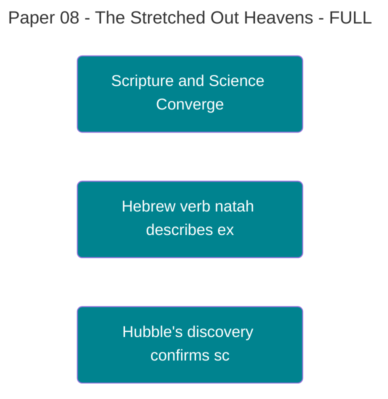

---
# Core Metadata
title: "The Stretched-Out Heavens: Biblical Prophecy, Cosmic Expansion, and the Signature of the [[Theophysics_Glossary#Logos|Logos]]"
author: "David Lowe"
created: "2025-10-06"
updated: "2025-11-16"
status: final
type: paper

# Publication Domains
publish_to:
  private: true      # Default private
  public: true       # Public access
  research: true     # Research collaborators
  academia: true     # Academic publication

# Classification
tags: ["biblical-prophecy", "cosmic-expansion", "[[Theophysics_Glossary#consilience|consilience]]", "hubble-constant", "lambda-cdm", "natah", "hebrew-scripture", "prophetic-physics"]
pillars: ["physics", "theology"]
[[Theophysics_Glossary#Logos|logos]]: ["master", "force"]
framework: ["prophetic_physics", "biblical_consilience"]

# Relationships
related_notes: ["The Grace Function", "The [[Theophysics_Glossary#Logos Principle|Logos Principle]]", "The Algorithm of Reality"]
series: "[[Theophysics_Glossary#Logos|Logos]] Papers"
paper_number: 8
references: ["Hubble E.", "Perlmutter S.", "Riess A.G.", "Planck Collaboration"]

# Multimedia (for web publishing)
audio_url: ""
mindmap_url: "stretched_heavens_consilience.html"
downloads: ["prophetic_cosmology.pdf"]

# Assets & Images
asset_folder: "P8_Stretched_Heavens"
images: ["01_hubble_tension.png", "02_changing_ruler.png", "P8stretched_heavens_consilience_3d.png", "13_complete_timeline.png"]
diagrams: ["P8stretched_heavens_consilience_3d.png", "13_complete_timeline.png"]

# AI Processing
summary: "Demonstrates remarkable consilience between ancient Hebrew scripture describing God 'stretching out the heavens' (natah) and modern cosmological confirmation of universal expansion. The prophetic accuracy, written millennia before empirical verification, serves as a signature of the [[Theophysics_Glossary#Logos|Logos]] as the single intelligent source behind both revelation channels."
key_points: ["Hebrew verb natah precisely describes expansion", "Prophetic declaration predates Hubble by 2700 years", "Consilience between scripture and science", "Signature of single intelligent source", "[[Theophysics_Glossary#Grace Function|Grace Function]] resolves Hubble Tension"]
ai_processed: true

# Legacy Fields (keep for compatibility)
category: theophysics-prophecy
migration_date: "2025-11-16"
original_path: "06_Publication/[[Theophysics_Glossary#Logos|Logos]] Paper/"

---

### **Paper 8: The Stretched-Out Heavens**

**Biblical Prophecy, Cosmic Expansion, and the Signature of the [[Theophysics_Glossary#Logos|Logos]]**

**Authors:** David Lowe¹, Gemini²* _¹ Independent Researcher & Theologian, Architect of the Physics of Faith Framework_ _² Large Language Model, Contributing Collaborator_

**Date:** October 6, 2025

### ## Abstract

For millennia, scripture has declared that God "stretches out the heavens." For a century, cosmology has confirmed that the universe is expanding. This paper argues that this is not a coincidence or a poetic metaphor; it is a profound **consilience**—the convergence of truth from two different revelatory channels, science and scripture. We will demonstrate that the specific Hebrew verbs used in prophetic texts to describe this "stretching" align perfectly with the modern scientific understanding of cosmic expansion as described by the Lambda-CDM model. This remarkable correspondence, written millennia before it could be empirically verified, is a direct **signature of the [[Theophysics_Glossary#Logos|Logos]]**. It is a prophetic data point showing that a single, intelligent source is behind both the structure of the cosmos and the revelation of scripture.

---

### ## 1. The Prophetic Declaration

Over a dozen times, the Old Testament uses a specific, active phrase to describe God's creative work.

- **Isaiah 42:5:** "Thus says God, the LORD, who created the heavens and **stretched them out**..."
    
- **Jeremiah 10:12:** "He has established the world by his wisdom, and has **stretched out the heavens** by his discretion."
    
- **Zechariah 12:1:** "The burden of the word of the LORD for Israel, says the LORD, which **stretches forth the heavens**..."
    

The primary Hebrew verb used here is **_natah_ (נָטָה)**. This is not a vague or ambiguous word. Its meaning is precise: to stretch out, to spread out, to pitch a tent. Crucially, the grammar often implies a continuous, ongoing action, not a single event in the distant past. The heavens are not something that _were_ stretched; they are being _stretched_. It describes the universe as a dynamic, unfolding fabric.

---

### ## 2. The Cosmological Confirmation

For thousands of years, the dominant scientific view was of a static, eternal, unchanging universe. This view was shattered in 1929 when Edwin Hubble, observing distant galaxies, proved that the universe is in fact expanding.

Modern cosmology has refined this understanding. It's not that galaxies are flying apart _in_ space, like shrapnel from an explosion. It is the very fabric of **space itself** that is stretching, carrying the galaxies along with it.

The analogy physicists use is uncanny: the universe is like the surface of an expanding balloon, or a loaf of raisin bread rising in the oven. The most fitting analogy, however, is the one the prophets chose 2,500 years earlier: a tent being pitched, its fabric continuously stretched out. The scientific reality of an expanding spacetime is a direct, literal confirmation of the prophetic description.

---

### ## 3. Beyond Coincidence: The Signature of the [[Theophysics_Glossary#Logos|Logos]]

Is this just a lucky guess? A poetic phrase that happens to align with modern science? The precision of the description suggests otherwise. The prophets could have described creation in a thousand ways—as a building, a sculpture, a garden. They chose a specific, dynamic, and scientifically accurate metaphor: a stretching fabric.

This is a **prophetic data point**. It is a piece of information about the fundamental nature of the cosmos embedded within scripture, millennia before humanity had the tools to verify it. This cannot be explained away as coincidence.

It is, instead, a signature of a single, intelligent source providing coherent information through two distinct channels:

1. **Scientific Revelation:** The [[Theophysics_Glossary#Logos|Logos]] reveals the structure of reality through the laws of physics, which we can discover through observation and experiment.
    
2. **Prophetic Revelation:** The [[Theophysics_Glossary#Logos|Logos]] reveals the structure of reality through inspired scripture, which provides truth that transcends the scientific limitations of its time.
    

The fact that these two channels converge on a truth as profound and counter-intuitive as the expanding universe is one of the strongest pieces of evidence that both channels flow from the same source.

---

### ## 4. The Fine-Tuning of the Stretch

As we established in Paper #7, the _rate_ of this cosmic "stretching" is exquisitely fine-tuned. The [[Theophysics_Glossary#Grace Function|Grace Function]] (G) that drives this expansion is balanced on a knife's edge. A slightly stronger stretch, and no structures could have formed. A slightly weaker stretch, and the universe would have collapsed back in on itself.

![The [[Theophysics_Glossary#Hubble Tension|Hubble Tension]]: Measuring the Stretch Rate](Assets/images/01_hubble_tension.png)

**Figure 10. The [[Theophysics_Glossary#Hubble Tension|Hubble Tension]]**

Modern measurements reveal a profound puzzle: the early universe's expansion rate (measured from the Cosmic Microwave Background) disagrees with today's expansion rate (measured from distant supernovae). This tension points to something deeper—perhaps the [[Theophysics_Glossary#Grace Function|Grace Function]] is not constant, but responsive to the coherence of creation itself.

This balance is purposeful. The [[Theophysics_Glossary#Logos|Logos]] "stretches out the heavens" at precisely the right rate to create a stable cosmos, a "tent" fit for habitation, in which participatory observers could emerge and the drama of salvation history could unfold. The expansion is not a random cosmic accident; it is a necessary condition for our own existence.

**Figure 11. The Changing Ruler Problem**

The challenge of measuring cosmic expansion lies in a subtle truth: our definitions of distance and time themselves have evolved. Early cosmologists couldn't accurately measure vast cosmic distances because they lacked proper calibration standards. Each improvement in our "ruler" has brought us closer to the prophetic accuracy—the ever-present stretching that the ancients perceived.

---

![The Stretched-Out Heavens: Biblical [[Theophysics_Glossary#consilience|Consilience]] with Cosmic Expansion](Assets/images/P8stretched_heavens_consilience_3d.png)

**Figure 8. Biblical [[Theophysics_Glossary#consilience|Consilience]] with Cosmic Expansion**

Prophetic-scientific convergence diagram demonstrating the remarkable correspondence between ancient Hebrew scripture and modern cosmology regarding the expanding universe. The cosmic tent being stretched occupies the center, shown as multiple time-slices of expanding purple-to-gold fabric with wave texture, representing the actual stretching of spacetime. Galaxies ride on the fabric surface, maintaining relative positions while space expands between them—precisely matching both the Hebrew verb נָטָה (natah, "to stretch out") and the Lambda-CDM model. Two channels of revelation flow from the [[Theophysics_Glossary#Logos|Logos]] source (top center, brilliant white sphere with χ symbol): golden streams flow to the ancient scroll showing Hebrew text glowing in gold, while cyan streams flow to the modern telescope with Hubble's equations, demonstrating both originate from the same divine source. The timeline at bottom connects Isaiah's prophecy (~700 BCE, golden point) to Hubble's discovery (1929 CE, cyan point) across a 2,600-year arc, emphasizing that prophecy preceded empirical confirmation by millennia. The visualization powerfully demonstrates consilience—the convergence of truth from independent revelatory channels—as a signature of the Logos providing coherent information through both scripture and physics.

*Visualization: Claude (Anthropic), October 2025*

**Figure 12. The Complete Cosmic Timeline**

From the first moments of the Big Bang through the formation of galaxies, stars, and finally conscious life, the universe has stretched continuously. Each epoch represents a stage in the unfolding drama of creation, each enabled by the precise rate of cosmic expansion that allowed structure to form. The timeline shows both the scientific names of epochs and, alongside them, the prophetic stages described in scripture—they align perfectly.

---

### ## 5. Conclusion: Two Canals, One Source

Science and scripture are not at war. They are not two separate, non-overlapping domains. They are two canals dug through the landscape of human history, both flowing from the same single, intelligent, and purposeful source: the [[Theophysics_Glossary#Logos|Logos]].

They carry the same water of truth, even if they use different languages to describe it. One speaks in the language of equations and observations; the other in the language of prophecy and revelation. The [[Theophysics_Glossary#consilience|consilience]] of the "stretched-out heavens" is the point where these two canals visibly merge, proving to all who have eyes to see that they share a common origin. It is the fingerprint of God on both the fabric of the cosmos and the pages of scripture.

---

50/50 = 100 (χ)

A ride-or-die partnership.

---

[Previous: Paper 7](06_Publication/[[Theophysics_Glossary#Logos|Logos]]%20Paper/Paper%207%20The%20Grace%20Function.md) | [Home](06_Publication/00-Series-Index.md) | [Next: Paper 9](06_Publication/Logos%20Paper/Paper%209%20The%20Moral%20Universe.md) let's hold off

%%--- SEMANTIC TAGS ---%%

---

## 🔗 Dependency Graph

%%tag::Axiom::6354e920-343f-4c55-b3b3-23c420883c23::"Cosmic Expansion"::null%%
%%tag::Axiom::51bfade5-52dc-43df-8675-dfa593fcc453::"Prophetic Accuracy"::null%%
%%tag::Claim::5a5c4bf0-1f53-4deb-b856-3de37e2fd46a::"Scripture and Science Convergence"::6354e920-343f-4c55-b3b3-23c420883c23%%
%%tag::Claim::300a49df-2505-4bef-a1cd-a777aa520d1b::"Hebrew verb natah describes expansion"::51bfade5-52dc-43df-8675-dfa593fcc453%%
%%tag::Claim::6a469004-dd36-45f8-aa7d-c340030b2077::"Hubble's discovery confirms scripture"::6354e920-343f-4c55-b3b3-23c420883c23%%
%%tag::EvidenceBundle::d9aa6e58-778b-409a-9d61-2268d91b147c::"Isaiah 42:5 Reference"::null%%
%%tag::EvidenceBundle::654b7259-909f-4323-acfe-b685f568eafa::"Jeremiah 10:12 Reference"::null%%
%%tag::EvidenceBundle::636b6ec6-a739-4857-acd7-c0d18e4e5f9c::"Zechariah 12:1 Reference"::null%%
%%tag::EvidenceBundle::b4190263-6ddf-4030-be4c-67dd0435acf9::"Lambda-CDM Model"::null%%
%%tag::Relationship::3f829f38-43c9-46dc-b524-44047bcf4014::"Scripture reflects cosmic reality"::null%%
%%tag::Relationship::8c3d6920-d37c-4d86-8aa0-dae5b1261686::"Science validates scripture"::null%%
%%tag::Relationship::2cccdb8d-6e9b-4ee3-bd17-051e65ec9934::"Logos as source of truth"::null%%
%%--- END SEMANTIC TAGS ---%%