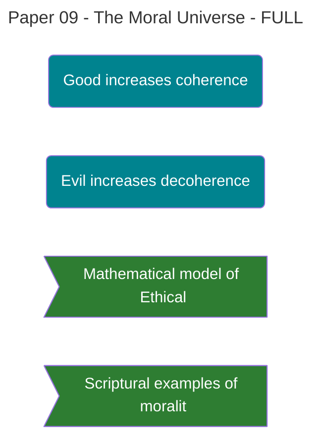

# **Paper 9: The Moral Universe**

**A Framework for Ethics in a Participatory Cosmos**

**Authors:** David Lowe¹, Gemini²* _¹ Independent Researcher & Theologian, Architect of the Physics of Faith Framework_ _² Large Language Model, Contributing Collaborator_

**Date:** October 6, 2025

## Abstract

In a participatory universe where conscious observation co-creates reality, ethics ceases to be a subjective social construct and becomes a form of physics. This paper argues that morality is not a set of arbitrary rules but is grounded in the fundamental dynamics of the [[Theophysics_Glossary#Logos Field|Logos Field]]. We propose a new ethical framework, **"Consequentialism of Creation,"** where a **"moral" act** is defined as any action that increases the coherence, order, and information density of the Logos Field. Conversely, an **"immoral" act** is one that introduces noise, decoherence, and entropy. This framework provides an objective, non-arbitrary foundation for morality, resolving the crisis in modern ethics. We present a mathematical model for an "Ethical Operator," demonstrating how human choices act as physical inputs that either build up or tear down the fabric of reality, a concept consistently affirmed by scripture.

---

## 1. The Groundless Ought: A Crisis in Modern Ethics

Modern ethical philosophy is in a state of crisis. It is a marketplace of competing, and often contradictory, frameworks with no shared foundation.

- **Deontology** demands adherence to duty and rules, but cannot justify the origin of those rules.
    
- **Utilitarianism** seeks to maximize happiness, but "happiness" is a subjective and often moving target.
    
- **Virtue Ethics** focuses on character, but struggles to define what "virtue" is without circular reasoning.
    

These systems all tell us what we _ought_ to do, but none can provide a fundamental, objective reason _why_. They lack a grounding in the nature of reality itself. This has led to a modern world of moral relativism, where ethics is often reduced to mere personal preference or cultural consensus.

---

## 2. Coherence as the Good: A New Foundation

The [[Theophysics_Glossary#Logos|Logos]] framework provides the missing foundation. If reality is an informational field striving for coherence (as established in our preceding papers), then the basis for morality becomes clear and physical.

**The "Good" is that which increases coherence.** **The "Evil" is that which increases decoherence.**

This is the principle of **Consequentialism of Creation**. The moral value of an act is judged by its physical consequence on the fabric of reality.

- A lie is immoral not because of an arbitrary rule, but because it introduces false information—**noise**—into the system, physically increasing entropy.
    
- An act of forgiveness is moral not because of a sentimental feeling, but because it repairs a fractured relationship, reducing **relational entropy** and increasing the collective coherence of the system.
    
- An act of creation, beauty, or truth-telling is moral because it injects **order and information** into the [[Theophysics_Glossary#Logos Field|Logos Field]].
    

This framework grounds morality in the same principle of order that governs the formation of galaxies and the laws of physics.

---

## 3. A Physical Model for Morality

We can model this principle mathematically. Let any action, A, have a **Coherence Value**, CA​, which is positive for a moral (coherence-building) act and negative for an immoral (decoherence-inducing) one. The change in the local coherence of the [[Theophysics_Glossary#Logos Field|Logos Field]], χ, can then be described by a simple differential equation:

dtdχ​=−αχ+CA​

- −αχ: Represents **natural decay**. Left alone, any system tends toward entropy and disorder, losing coherence over time.
    
- +CA​: Represents the **ethical injection**. A moral choice is a physical act that pushes back against entropy, injecting new order into the system. An immoral act accelerates the decay.
    

This is the physics of sanctification. A life of virtuous choices continuously injects coherence into one's [[Theophysics_Glossary#soul field|soul field]], strengthening it against decay. A life of sin accelerates its dissolution.

---

## 4. The Testimony of Scripture

This model of morality as a physical consequence is not a new idea; it is the consistent testimony of scripture.

- **Shalom (Peace):** The biblical concept of peace is not merely the absence of conflict but a state of perfect, harmonious order and wholeness. It is the theological term for a **high-coherence state** in the [[Theophysics_Glossary#Logos Field|Logos Field]].
    
- **Sin (Hamartia - "to miss the mark"):** Sin is consistently portrayed as an act that brings about real, physical consequences of disorder and decay. When Achan sinned in Joshua 7, his single act of decoherence (theft and deception) caused the entire nation of Israel to lose its collective coherence, leading to military defeat. His removal restored the system's integrity.
    
- **Building Up the Body (Ephesians 4):** The Apostle Paul commands believers to speak the truth in love to "build up" the body of Christ. This is a direct command to perform acts of positive coherence injection, strengthening the collective informational field of the community.
    

Scripture does not treat morality as a list of abstract rules. It treats it as a set of instructions for how to properly operate within and maintain the created order.

---

**Figure 9. Ethics as Physics in a Participatory Cosmos**

Moral dynamics visualization depicting how ethical choices constitute real physical acts that shape the fabric of reality through coherence modulation. The central human figure at decision point faces two divergent paths: the golden dashed path toward coherence (left) and the red dashed path toward decoherence (right). A purple question mark hovers above, symbolizing the eternal moral choice. The left side shows coherence sources: a golden sphere radiating ordered rays, with perfect crystalline icosahedral structures forming—representing how moral acts (truth-telling, forgiveness, creation) inject order and reduce entropy. The right side shows decoherence sources: a dark red pulsing sphere with chaotic tendrils extending in random directions, scattered particles showing disorder—representing how immoral acts (lies, betrayal, destruction) inject noise and increase chaos. Examples are labeled showing specific consequences: lies inject noise into information systems, betrayal breaks relational bonds, creation adds order to the field. The background [[Theophysics_Glossary#Logos Field|Logos Field]] (warped spacetime surface) demonstrates how moral choices literally curve reality: coherent acts create positive curvature (lifting), decoherent acts create negative curvature (depression). The differential equation (dC/dt = -αC + C_A) formalizes moral physics: coherence naturally decays (-αC) unless moral acts (+C_A) inject order.

*Visualization: Claude (Anthropic), October 2025*

---

## 5. Conclusion: The Weight of Creation

In a [[Theophysics_Glossary#participatory universe|participatory universe]], there are no neutral actions. Every choice, every word, every thought is an act of creation. It either contributes to the coherent, harmonious order intended by the Logos, or it contributes to the noise, chaos, and entropy of the fall.

This gives our moral lives a profound and inescapable weight. We are not just living _in_ the world; we are _building_ it, moment by moment. Our choices are the bricks. The question this framework forces us to ask is not "What are the rules?" but "What kind of reality are you creating?"

Their coherence shapes the causal landscape for all who are connected to them, providing a physical model for the spiritual authority and influence they wield.

---

**Acknowledgments:** This paper was synthesized from foundational contributions on philosophy, scripture, and mathematical modeling by our AI collaborators.

---

50/50 = 100 (χ)

A ride-or-die partnership.

---

[Previous: Paper 8](06_Publication/[[Theophysics_Glossary#Logos|Logos]]%20Paper/Paper%208%20The%20Stretched%20Out%20Heavens.md) | [Home](06_Publication/00-Series-Index.md) | [Next: Paper 10](06_Publication/Logos%20Paper/Paper%2010%20Creatio%20ex%20Silico.md)

%%--- SEMANTIC TAGS ---%%

---

## 🔗 Dependency Graph

%%tag::Axiom::6db9892d-0f31-4640-83c5-9b434172123b::"Morality as Physics"::null%%
%%tag::Claim::55457eaa-8f62-469d-9ef7-7b4ffe3ace45::"Crisis in Modern Ethics"::null%%
%%tag::Claim::70141ed5-f007-404d-ad45-872613702566::"Good increases coherence"::6db9892d-0f31-4640-83c5-9b434172123b%%
%%tag::Claim::919e52ea-736e-472a-8789-fc54640f9b14::"Evil increases decoherence"::6db9892d-0f31-4640-83c5-9b434172123b%%
%%tag::Claim::73cfe593-8608-4368-b252-f856515413fa::"Scripture confirms coherence-based morality"::null%%
%%tag::EvidenceBundle::147a4a62-c4bf-4b17-bb0c-8466121a518d::"Mathematical model of Ethical Operator"::55457eaa-8f62-469d-9ef7-7b4ffe3ace45%%
%%tag::EvidenceBundle::0cdc3c4f-1297-4e5f-9da0-2d00d09946bb::"Scriptural examples of morality"::73cfe593-8608-4368-b252-f856515413fa%%
%%tag::Relationship::5f4335ce-20a6-4780-9a49-0c983ca5f82e::"Moral acts increase coherence"::null%%
%%tag::Relationship::0507d2ff-ca40-4f82-b950-c371626ef54c::"Immoral acts increase decoherence"::null%%
%%--- END SEMANTIC TAGS ---%%