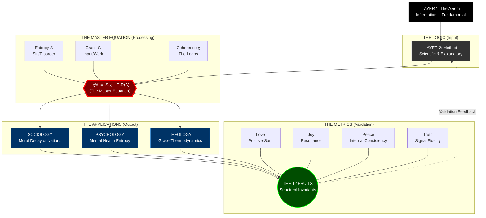

# VISUAL & DIGITAL ARCHITECTURE: THEOPHYSICS

This document provides the **Visual Model** and **Website Sitemap** to translate the "Trans-Domain Unity" thesis into a digital experience.

## I. The Master Visual Model (Mermaid)

This diagram visualizes the "Trans-Domain Nexus." It shows how foundational logic flows through the Master Equation, manifests in three domains, and is evaluated by the Fruits of the Spirit.

---

## II. Website Sitemap Strategy

This structure maps your folder hierarchy to a public-facing website navigation structure designed for clarity and authority.

### **1. HOME (The Interface)**
*   **Hero:** "The Only Top-Down Framework" (Visual: The Mermaid Diagram above)
*   **The Problem:** The Tri-Domain Collapse (Brief summary of Soc/Psych/Theo crisis)
*   **The Solution:** The Master Equation (Visual: The Equation)
*   **Call to Action:** "Read the Manifesto"

### **2. ABOUT (The Axioms)**
*   **Mission:** Trans-Domain Unity (The Master Synthesis Text)
*   **The Logic (Layer 1):** Informational Ground & Primitives
*   **The Method (Layer 2):** Why the Scientific Method is Necessary but Not Sufficient

### **3. RESEARCH (The Evidence)**
*   **Sociology:** "The Moral Decay of America" (1900-2025 Timeline)
*   **Psychology:** "Entropy in Mental Health" (The Triangulation Model)
*   **Theology:** "Thermodynamics of Grace" (Theophysics)
*   **Data:** The "Fragmentation Data" & Evidence Maps

### **4. METRICS (The Proof)**
*   **The Fruits Scorer:** Interactive explanation of the 12 Structural Invariants.
*   **UTDGS:** The Universal Theory Defense Grading System.
*   **Project Scores:** The "Master Coherence Analysis" Report.

### **5. SUBSTACK / PUBLICATIONS**
*   Recent Papers (Feed from `03_PUBLICATIONS`)
*   Manisfestos (The "Scientific Method Redux")

---

## III. The Master Equation (LaTeX Display)

For the website hero section, this equation should be displayed prominently.

**The Differential Form:**
$$ \frac{d\chi}{dt} = -S \cdot \chi + G \cdot R(\Lambda) $$

**Where:**
*   $\chi$ = **Coherence** (The Logos Field)
*   $S$ = **Entropy** (Sin / Disconnection)
*   $G$ = **Grace** (External Information Input)
*   $R(\Lambda)$ = **Reception Coefficient** (Faith/Openness)
